# Built without an approved design

Every piece of the app that was built **without an approved PNG**. The owners approved 58 screens; these parts are
not on any of them, so they were built from approved parts and the words already in the docs. Each one has the place
to see it, the words on it, and a screenshot. Send this file and the pictures to the owners in one batch.

- **Screenshots:** `docs/no-design/<id>.png`. They are made by `npm run shots:no-design` (it needs `npm run dev`
  running). Run it again after a change, and commit the new pictures.
- **To add a piece:** whenever you build something without a PNG (a state, a banner, a panel, a message), add a section
  here with its route, its words and a screenshot, and add its entry to `tests/no-design/no-design.counter.spec.ts`
  (or the owner version when there is one). A test, `src/no-design-doc.test.ts`, fails if a picture has no section or a
  section has no picture. The rule is also in `CLAUDE.md`.
- **Routes** are the development ones: the counter at `http://localhost:5173`, and `?now=` sets the demo clock
  (`docs/10_TESTING_AND_QA.md`).

| # | Piece | App | Built in |
|---|---|---|---|
| 1 | [Sign-in time banner](#1-sign-in-time-banner) | counter | P04 |
| 2 | [Switch worker offer](#2-switch-worker-offer) | counter | P04 |
| 3 | [Alerts panel (the bell)](#3-alerts-panel-the-bell) | counter | P04 answers |
| 4 | [Alerts panel with nothing in it](#4-alerts-panel-with-nothing-in-it) | counter | P04 answers |
| 5 | [Wrong PIN on the sign-in page](#5-wrong-pin-on-the-sign-in-page) | counter | P04 |
| 6 | ["Wait 5 minutes" on the sign-in page](#6-wait-5-minutes-on-the-sign-in-page) | counter | P04 |
| 7 | [The sign-in page when the workers cannot be loaded](#7-the-sign-in-page-when-the-workers-cannot-be-loaded) | counter | P04 |
| 8 | [Wrong PIN on the lock screen](#8-wrong-pin-on-the-lock-screen) | counter | P04 |
| 9 | [Foosball, carrom, ludo and PlayStation before a price is set](#9-foosball-carrom-ludo-and-playstation-before-a-price-is-set) | counter | P05 |
| 10 | [The board when the tables cannot be loaded](#10-the-board-when-the-tables-cannot-be-loaded) | counter | P05 |
| 11 | [Waiting to pay with nobody waiting](#11-waiting-to-pay-with-nobody-waiting) | counter | P05 |
| 12 | [The pages of pool, carrom, foosball, ludo and PlayStation once prices are set](#12-the-pages-of-pool-carrom-foosball-ludo-and-playstation-once-prices-are-set) | counter | P05 answers |
| 13 | [Mark out of order: the note](#13-mark-out-of-order-the-note) | counter | P06 |
| 14 | [A table that cannot be started](#14-a-table-that-cannot-be-started) | counter | P06 |
| 15 | [Starting pool, foosball, carrom, ludo and PlayStation](#15-starting-pool-foosball-carrom-ludo-and-playstation) | counter | P06 |
| 16 | [Starting a Century: one player](#16-starting-a-century-one-player) | counter | P06 |
| 17 | [The players screen before anything is typed](#17-the-players-screen-before-anything-is-typed) | counter | P06 |
| 18 | [Add a new player: the number is not whole](#18-add-a-new-player-the-number-is-not-whole) | counter | P06 |
| 19 | [Change the game type: who plays after the change](#19-change-the-game-type-who-plays-after-the-change) | counter | P06 |
| 20 | [The panel of a Century, a room or a double](#20-the-panel-of-a-century-a-room-or-a-double) | counter | P07 |
| 21 | [The panel in the first 5 minutes: Change game type](#21-the-panel-in-the-first-5-minutes-change-game-type) | counter | P07 |
| 22 | [Move a room, and the players to pick from](#22-move-a-room-and-the-players-to-pick-from) | counter | P07 |
| 23 | [Stop a frame: the dispute and the cancel](#23-stop-a-frame-the-dispute-and-the-cancel) | counter | P07 |
| 24 | [Damage charge: nothing picked yet](#24-damage-charge-nothing-picked-yet) | counter | P07 |
| 25 | [Undo done](#25-undo-done) | counter | P07 |
| 26 | [Pause all from the action bar](#26-pause-all-from-the-action-bar) | counter | P07 |
| 27 | [Put a table back in order](#27-put-a-table-back-in-order) | counter | P07 answers |
| 28 | [A table an owner marked](#28-a-table-an-owner-marked) | counter | P07 answers |
| 29 | [Which side lost: one pays all, and a custom split](#29-which-side-lost-one-pays-all-and-a-custom-split) | counter | P08 |
| 30 | [Charge double? for a double frame](#30-charge-double-for-a-double-frame) | counter | P08 |
| 31 | [Start a room: nobody picked yet](#31-start-a-room-nobody-picked-yet) | counter | P08 |
| 32 | [Undo on the next-frame screen](#32-undo-on-the-next-frame-screen) | counter | P08 |
| 33 | [After a payment: the note on the checkout list](#33-after-a-payment-the-note-on-the-checkout-list) | counter | P09 |
| 34 | [Checkout: Owes from before](#34-checkout-owes-from-before) | counter | P09 |
| 35 | [Checkout: search any player](#35-checkout-search-any-player) | counter | P09 |
| 36 | [A bill that uses an advance](#36-a-bill-that-uses-an-advance) | counter | P09 |
| 37 | [Part payment: paying more than the total](#37-part-payment-paying-more-than-the-total) | counter | P09 |
| 38 | [Give a discount: changing or removing it](#38-give-a-discount-changing-or-removing-it) | counter | P09 |
| 39 | [Money actions ask once: the confirm sheet](#39-money-actions-ask-once-the-confirm-sheet) | counter | P09 answers |
| 40 | [Undo after a charged frame: Nobody pays](#40-undo-after-a-charged-frame-nobody-pays) | counter | P09 answers |
| 41 | [The Undo toast after a payment](#41-the-undo-toast-after-a-payment) | counter | P09 answers |
| 42 | [The Undo toast after a charged frame](#42-the-undo-toast-after-a-charged-frame) | counter | P09 answers |
| 43 | [Canteen: nobody picked yet](#43-canteen-nobody-picked-yet) | counter | P10 |
| 44 | [Canteen: a cash sale](#44-canteen-a-cash-sale) | counter | P10 |
| 45 | [Expense from the drawer: nothing picked yet](#45-expense-from-the-drawer-nothing-picked-yet) | counter | P10 |
| 46 | [Expense from the drawer: the Undo toast after it is saved](#46-expense-from-the-drawer-the-undo-toast-after-it-is-saved) | counter | P10 |
| 47 | [Players: nobody picked yet](#47-players-nobody-picked-yet) | counter | P10 |
| 48 | [Players: Advance](#48-players-advance) | counter | P10 |
| 49 | [Today’s totals: nobody waiting to pay](#49-todays-totals-nobody-waiting-to-pay) | counter | P10 |
| 50 | [Close sheet: a note is needed](#50-close-sheet-a-note-is-needed) | counter | P10 |
| 51 | [Close sheet: the confirm sheet](#51-close-sheet-the-confirm-sheet) | counter | P10 |
| 52 | [Sheet closed: nothing moved](#52-sheet-closed-nothing-moved) | counter | P10 |
| 53 | [The Undo toast after a double, a game, a Century or a room](#53-the-undo-toast-after-a-double-a-game-a-century-or-a-room) | counter | P10 answers |
| 54 | [The Undo toast after a canteen sale](#54-the-undo-toast-after-a-canteen-sale) | counter | P10 answers |
| 55 | [Expense from the drawer: it asks once](#55-expense-from-the-drawer-it-asks-once) | counter | P10 answers |
| 56 | [Start a room: the price of an hour has a range](#56-start-a-room-the-price-of-an-hour-has-a-range) | counter | P10 answers |
| 57 | [Owner sign-in: a wrong password](#57-owner-sign-in-a-wrong-password) | owner | P11 |
| 58 | [Owner sign-in: wait 15 minutes](#58-owner-sign-in-wait-15-minutes) | owner | P11 |
| 59 | [Owner sidebar: Sign out](#59-owner-sidebar-sign-out) | owner | P11 |
| 60 | [Owner phone: the More sheet](#60-owner-phone-the-more-sheet) | owner (phone) | P11 |
| 61 | [Dashboard: nothing needs a look](#61-dashboard-nothing-needs-a-look) | owner | P12 |
| 62 | [Dashboard: the tip on a bar](#62-dashboard-the-tip-on-a-bar) | owner | P12 |
| 63 | [Activity: a dispute decided](#63-activity-a-dispute-decided) | owner | P12 |
| 64 | [Activity: nothing for this filter](#64-activity-nothing-for-this-filter) | owner | P12 |
| 65 | [Activity on a phone](#65-activity-on-a-phone) | owner (phone) | P12 |
| 66 | [Reports: Year](#66-reports-year) | owner | P12 |
| 67 | [Reports: Day](#67-reports-day) | owner | P12 |
| 68 | [Reports on a phone](#68-reports-on-a-phone) | owner (phone) | P12 |

Below the numbered pieces there are also [the approved screens that change](#approved-screens-that-change-a-field-or-a-word) (the maximum time of a game). Those are built in P15 and P16, so they have no picture yet.

## 1. Sign-in time banner

- **What:** a strip across the top of every counter screen, from 10 minutes before a worker's sign-in time ends. It
  has no button: it goes when the worker is signed out at the end of his time.
- **Where:** any counter screen at that time, for example `/?now=2026-10-03T22:51:00%2B05:00` (Zain's time ends at 11:00 PM).
- **Words:** "Your sign-in time ends at 11:00 PM. Finish what you are doing." (the words are in `docs/08` §3).
  Urdu: "آپ کے سائن اِن کا وقت رات 11:00 پر ختم ہو رہا ہے۔ جو کام کر رہے ہیں وہ ختم کر لیں۔"
- **Built from:** the amber warning colours of screens 25 and 26.

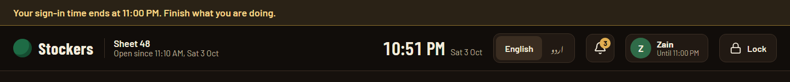

## 2. Switch worker offer

- **What:** a small box under the worker chip in the top bar. Tapping the chip ("Zain, Until 11:00 PM") offers one
  button, "Switch worker", which signs the worker out and shows the sign-in page. A tap outside it, or Escape, closes it.
- **Where:** any counter screen, for example `/`; tap the worker chip.
- **Words:** "Switch worker" (from screen 34). Urdu: "کارکن بدلیں".
- **Built from:** the colours of the counter panels; the button is 56 px tall like every counter button.

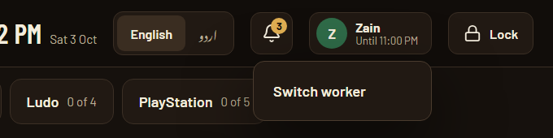

## 3. Alerts panel (the bell)

- **What:** tapping the bell opens a panel on the end side of the screen (the right in English, the left in Urdu), with
  the board dimmed behind it. It lists the counter's own alerts, newest first: a title, one line of text, the time at
  the end of the row, and an amount if the alert has one. An unread alert has a dot. "Mark all read" is in the
  header; closing the panel (the X, or Escape) goes back to the board. It shows **counter alerts only**, never the
  owners' notifications.
- **Where:** `/alerts`, or tap the bell on any counter screen.
- **Words:** "Alerts", "Mark all read". Urdu: "اطلاعات", "سب پڑھی ہوئی کریں". The titles and lines come from the club's
  data (for example "Chips running low", "3 left. Cigarette packs are sold out.").
- **Built from:** the counter side panel of screen 11 and the alert rows of screen 58 (the bar at the start of a row
  says what kind of alert it is). The owners' answer of 15 Oct 2026 describes it.

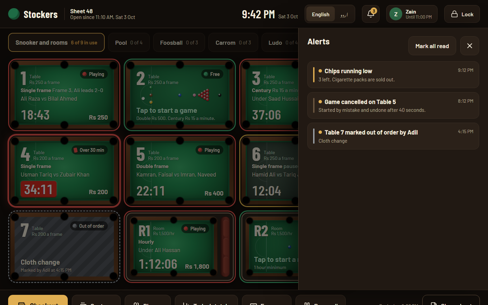

## 4. Alerts panel with nothing in it

- **What:** what the panel says when there are no alerts, and "Mark all read" has nothing to do.
- **Where:** `/alerts` when the list is empty. (The picture is made with the list answered empty.)
- **Words:** "No alerts yet". Urdu: "ابھی کوئی اطلاع نہیں".

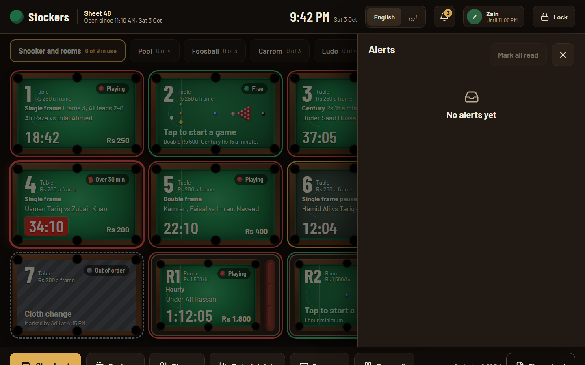

## 5. Wrong PIN on the sign-in page

- **What:** after a wrong PIN the four dots shake once and empty, and the line above them changes to the message, in red.
- **Where:** `/sign-in`, pick Zain, type 9999.
- **Words:** "Wrong PIN. Try again." (from `docs/08` §3). Urdu: "پن غلط ہے۔ دوبارہ کوشش کریں۔"

## 6. "Wait 5 minutes" on the sign-in page

- **What:** after 5 wrong PINs the keypad stops for 5 minutes and the line above the dots says so.
- **Where:** `/sign-in`, pick Zain, type 9999 five times.
- **Words:** "Wait 5 minutes" (from `docs/08` §3). Urdu: "5 منٹ انتظار کریں".

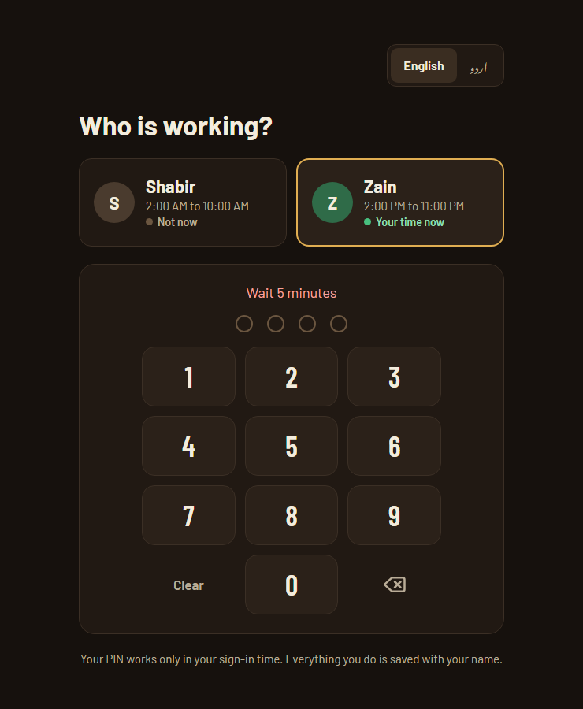

## 7. The sign-in page when the workers cannot be loaded

- **What:** if the list of workers does not load, the page says so and has a button to try again.
- **Where:** `/sign-in` when the club's computer cannot reach the server. (The picture is made with that call failing.)
- **Words:** "Could not load the workers.", "Try again". Urdu: "کارکنوں کی فہرست نہیں کھل سکی۔", "دوبارہ کوشش کریں".

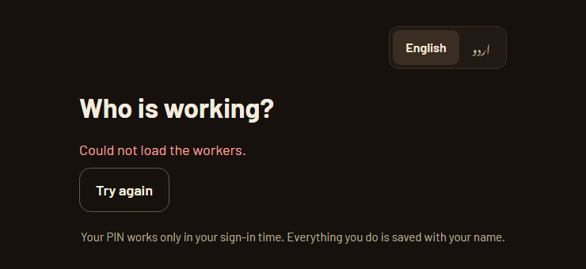

## 8. Wrong PIN on the lock screen

- **What:** the same message as the sign-in page, under the keypad of the lock screen (it does not move the keys).
- **Where:** `/?locked=1`, type 0000.
- **Words:** "Wrong PIN. Try again." Urdu: "پن غلط ہے۔ دوبارہ کوشش کریں۔"

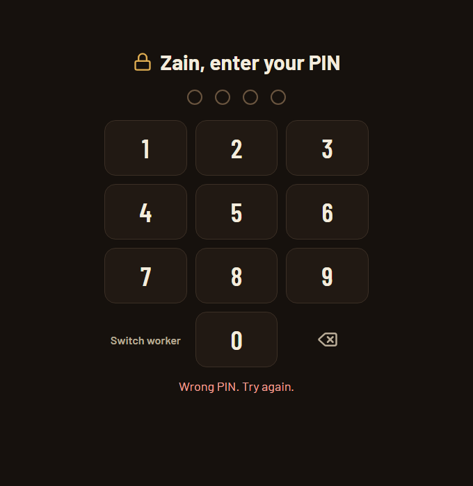

## 9. Foosball, carrom, ludo and PlayStation before a price is set

- **What:** screen 4 draws this only for pool. The other four games get the same page while their price is not set: the
  amber box, the locked tiles (the picture of each game, "Price not set", and "Locked until an owner sets the price"), and
  the two cards under them. Tapping a locked tile does nothing. Once an owner sets the prices the page shows the
  tiles as screen 5 draws them (a grid for each game, with no banner and no cards).
- **Where:** `/board/foosball`, `/board/carrom`, `/board/ludo`, `/board/playstation` (the picture shows foosball).
- **Words:** the title is "{games} have no price yet": "Foosball tables have no price yet", "Carrom boards have no price
  yet", "Ludo boards have no price yet", "PlayStation screens have no price yet". The line under it is the one on screen 4
  with "tables", "boards" or "screens" in it: "An owner sets the price in Games and prices. Until then these boards cannot
  be started." The two cards are word for word the ones on screen 4. Urdu: see `docs/URDU_TO_CHECK.md`.
- **Built from:** screen 4 (the banner, the locked tile, the two cards) and the tiles of screen 5.

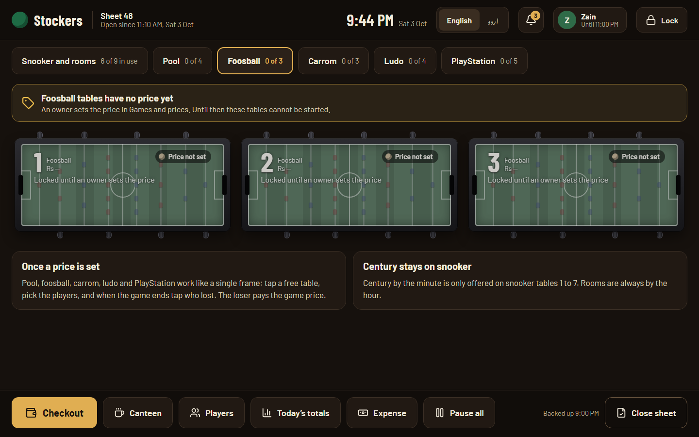

## 10. The board when the tables cannot be loaded

- **What:** if the club's computer cannot reach the server, the board area says so and has a button to try again. While
  the tables are loading it says "Loading the tables…" in the same place. The top bar and the action bar stay.
- **Where:** `/` when the board call fails. (The picture is made with that call failing.)
- **Words:** "Could not load the tables.", "Try again", "Loading the tables…". Urdu: "ٹیبلز نہیں کھل سکے۔",
  "دوبارہ کوشش کریں", "ٹیبلز کھل رہے ہیں…".
- **Built from:** the same message and button as the sign-in page that cannot load the workers (section 7).

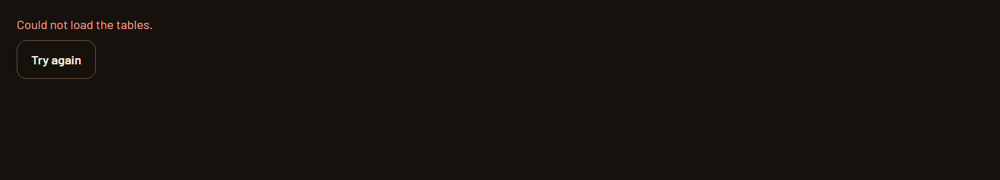

## 11. Waiting to pay with nobody waiting

- **What:** the "Waiting to pay" panel keeps its title, says "0 players", and says that nobody is waiting. The total
  line is not shown, because there is nothing to add up.
- **Where:** `/` when every bill is paid, for example `/?scenario=closed` (3:45 AM, after the sheet was closed).
- **Words:** "Nobody is waiting to pay". Urdu: "کسی کی ادائیگی باقی نہیں".
- **Built from:** the panel of screen 3.

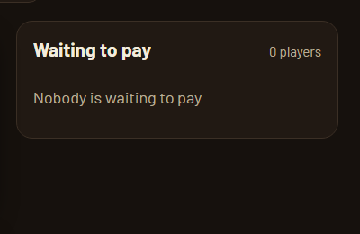

## 12. The pages of pool, carrom, foosball, ludo and PlayStation once prices are set

- **What:** no PNG draws the real page of these games with prices set (screen 5 is a preview, with a heading for each game).
  Once an owner has set the prices, `/board/<game>` shows that game's tiles in the grid of screen 5 under the tabs: no
  heading (the selected tab already names the game), no amber box and no cards. A table that still has no price stays
  locked with "Price not set". There is no waiting list on these tabs, as on screens 4 and 5.
- **Where:** `/board/carrom`, `/board/pool`, `/board/foosball`, `/board/ludo`, `/board/playstation` after the prices are set
  (the picture is made with Rs 50 on every carrom board).
- **Words:** the ones on the tiles of screen 5: "Carrom", "Rs 50 a game", "Tap to start", "The loser pays the game".
  Urdu: see `docs/URDU_TO_CHECK.md`.
- **Built from:** the tiles and the grid of screen 5 and the tab bar of screen 3.

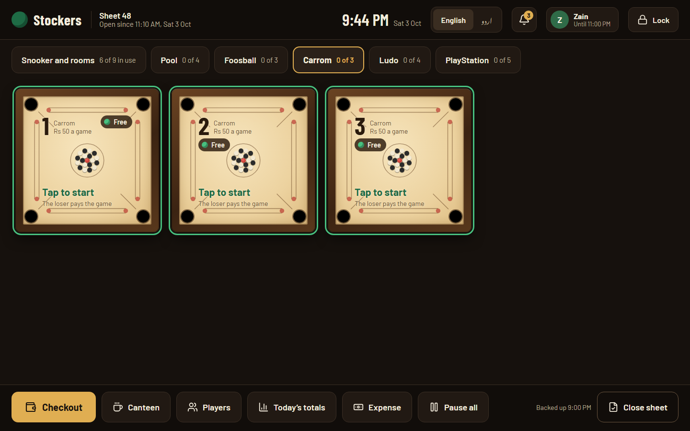

## 13. Mark out of order: the note

- **What:** the "Mark out of order" button of screen 7 asks for a note before it does anything. The table then turns grey with the note
  on the board, and the counter's bell gets an alert. Only a free table can be marked. The event is written in Activity with the worker's name.
  A worker can put back a table another worker marked ([27](#27-put-a-table-back-in-order)); answered by the developer on 17 Oct 2026.
- **Where:** `/table/t2/start/out-of-order` (from "Mark out of order" on `/table/t2/start`).
- **Words:** "Mark Table 2 out of order", "Write why, for example “Cloth change”. Everyone sees it on the table.", "Note (required)",
  "Mark out of order", "Cancel". Urdu: see `docs/URDU_TO_CHECK.md`.
- **Built from:** the dialog of screen 7 with the round brass ball and wrench of screen 15, and the note box of screens 14 and 15.

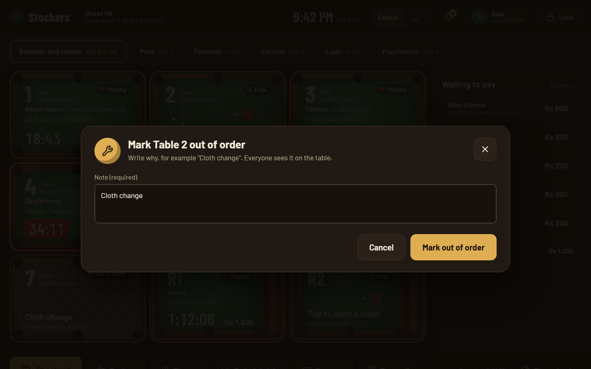

## 14. A table that cannot be started

- **What:** a table with no price cannot start a game. Its start dialog says why and has one way out. The board does not open this
  dialog by a tap (those tiles do nothing), so it is only reached by the address. A table that is out of order is different: a tap
  opens the dialog that puts it back in order ([27](#27-put-a-table-back-in-order)), and its `/start` address goes there.
- **Where:** a pool table with no price: `/board/pool/table/po1/start`.
- **Words:** "Pool table 1 has no price yet" with "Locked until an owner sets the price" (the words of screen 4), and "Cancel".
- **Built from:** the dialog of screen 7.

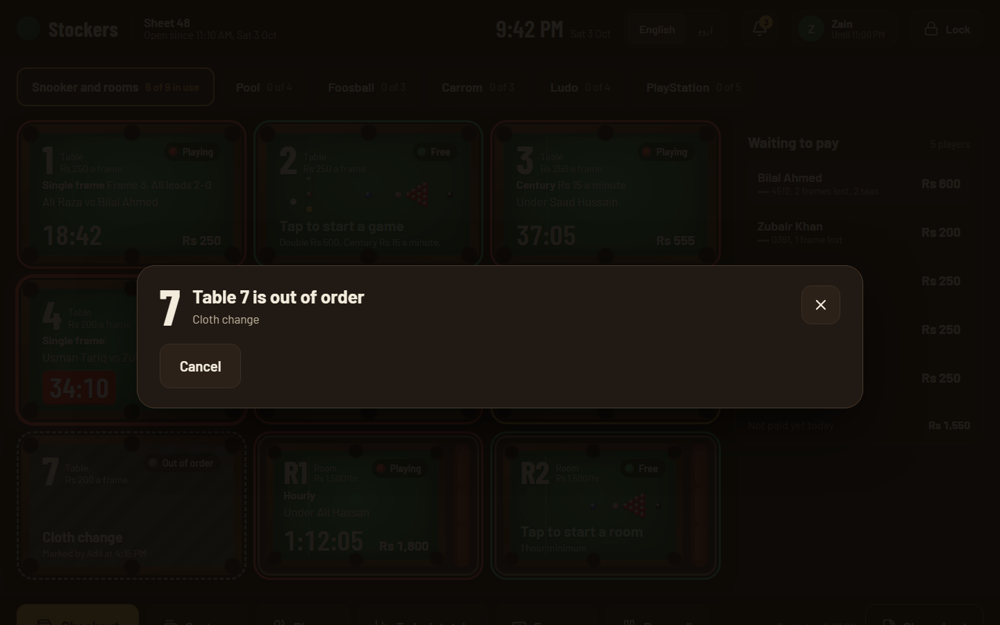

## 15. Starting pool, foosball, carrom, ludo and PlayStation

- **What:** these games have one kind of game, so there is no type step: the tap opens the two players straight away (screen 8), with
  "Game, Rs 300. The loser pays." under the title, no Back button and no "Step 2 of 2". Closing goes back to the tab you were on.
- **Where:** `/board/pool/table/po1/start/players` once an owner has set the price (the picture is made with Rs 300 on every pool table).
- **Words:** "Who is playing on Pool table 1?", "Game, Rs 300. The loser pays.", then the words of screen 8.
- **Built from:** screen 8.
- **When the game ends:** the same "Who lost this game?" as screen 17 ("Pool table 1, game ended at 9:42 PM after 12 minutes"), with
  "game" where it says "frame". The loser is charged the game price and the table is free; there is no next-frame screen. Past the game's
  own limit it asks "Charge double?" first (screen 19).

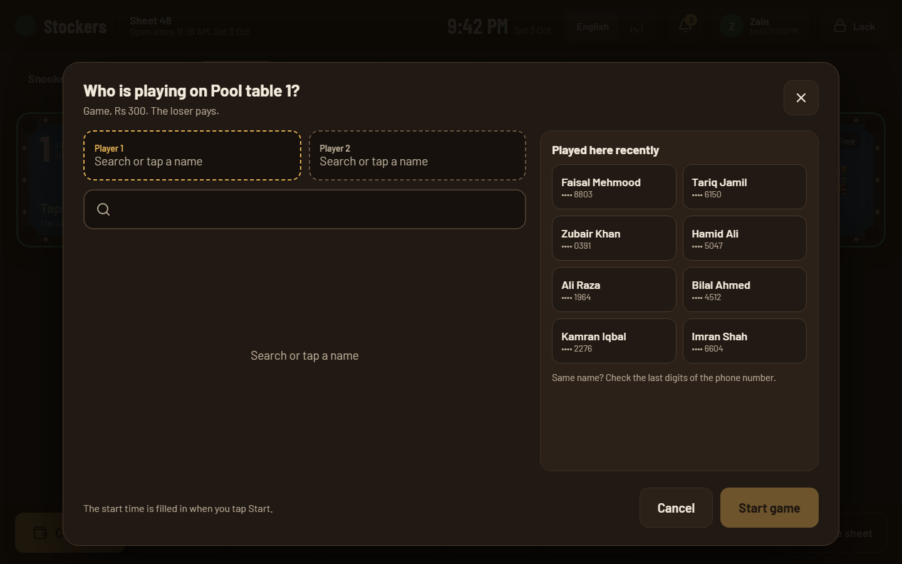

## 16. Starting a Century: one player

- **What:** a Century is charged under one player (D11), so the players screen has one slot instead of two and Start is ready once he is
  picked. The title line says the rate chosen on screen 7.
- **Where:** `/table/t2/start`, pick Century, "Next: pick players".
- **Words:** "Century, Rs 15 a minute. Charged under one player." and "Player 1".
- **Built from:** screen 8.

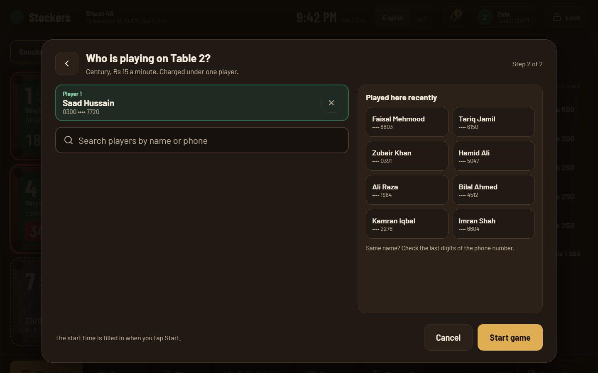

## 17. The players screen before anything is typed

- **What:** screen 8 is drawn with a search typed in. Before that, the box says what it is for, the list under it is empty (the
  space is kept, so the dialog does not move when the first letter is typed), and the players who played here recently are on the end
  side. Each result also has one plain line at its end, the first that applies: where he is playing ("Playing on Table 1", "In Room 1"),
  what he owes ("Owes Rs 1,200"), or when he last played ("Last played today", "Last played yesterday", "Last played Thursday" within
  six days, then "Last played 24 Sep"). It is information, never a warning. The count says "7 found" where screen 8 draws "4 found": the
  seed has seven names that start a word with "ali", counting Hamid Ali and Rizwan Ali.
- **Where:** `/table/t2/start/players`.
- **Words:** "Search players by name or phone" (the box), "Search or tap a name" (the empty slot), "{{count}} found", "Last played today",
  "Last played yesterday", "Last played {{day}}".
- **Built from:** screen 8.

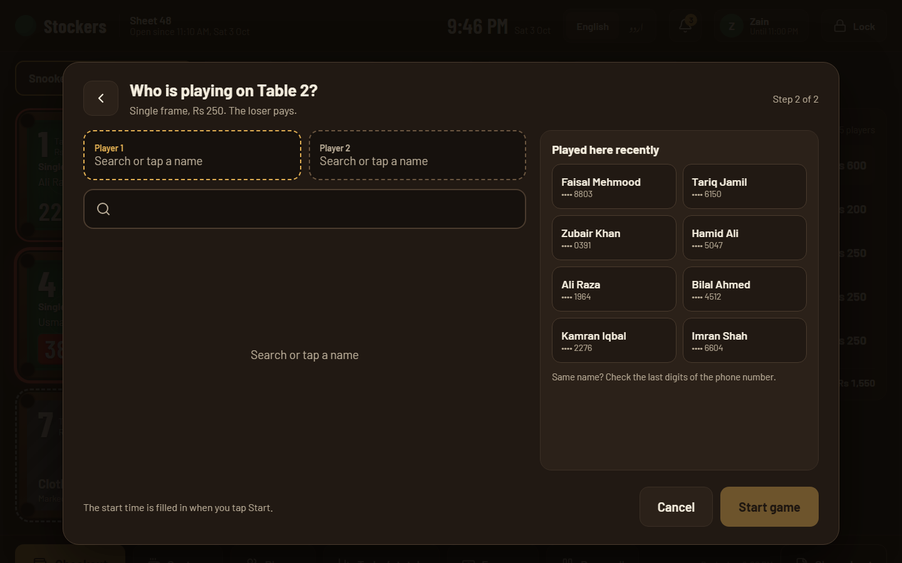

## 18. Add a new player: the number is not whole

- **What:** screen 10 draws "Add player" ready with "0302 81" typed, which is not a whole number. Tapping it then saves nothing and says
  what is missing under the phone box. A name with no number at all uses "Skip phone for now". Whole means 10 or 11 digits.
- **Where:** `/players/new?for=t2`, type a name and six digits, tap "Add player".
- **Words:** "Type the whole number, or tap “Skip phone for now”." Urdu: see `docs/URDU_TO_CHECK.md`.
- **Built from:** the red line of the PIN pad (screen 1) and the dialog of screen 10.

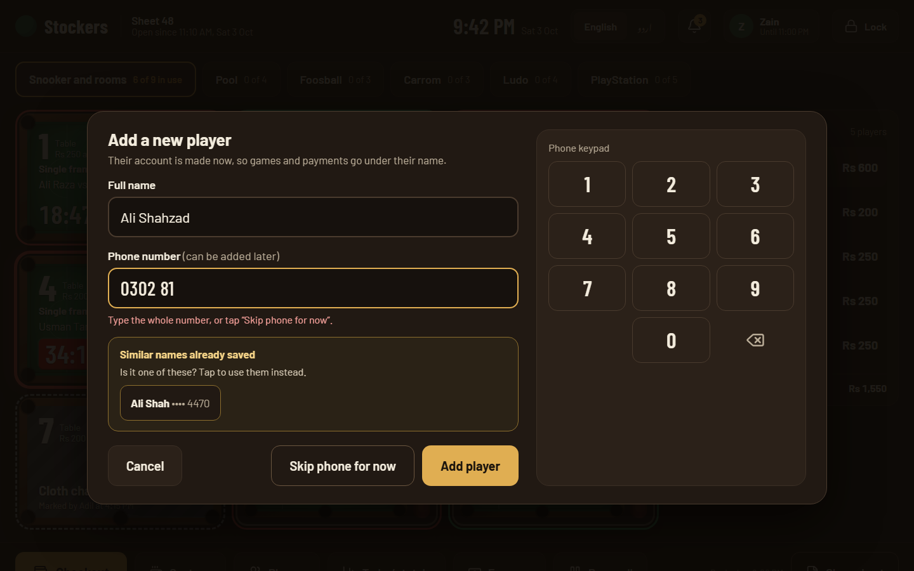

## 19. Change the game type: who plays after the change

- **What:** on screen 12 "Change to Century" cannot know who pays for the Century, or who is on which side of a double, so it goes on to
  the players (screen 8 or 9) with the game's own players already in the slots: the first player for a Century, the current pairs for a
  double, one player from each side for a single frame. The last button says "Change to Century" again and does the change. The game
  keeps its start time and counts from there. Back returns to the three choices. Every change between snooker types needs a name or the
  sides, so this step is always there. Answered by the developer on 17 Oct 2026.
- **Where:** `/table/t2/change-type?scenario=newGame` at 9:53 PM, pick Century, "Change to Century".
- **Words:** "Who is playing on Table 2?", "Change to Century", "Change to Double frame", "Back to game type".
- **Built from:** screens 8 and 9.

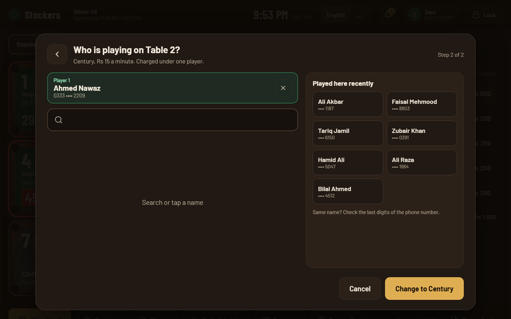

## 20. The panel of a Century, a room or a double

- **What:** screen 11 draws a single frame. The same panel serves every game on a table: a Century (title "Table 3, Century",
  "Century, Rs 15 a minute", "Under Saad Hussain", "End Century", no session score, a timer that is never the red card), a room
  ("Room, Rs 1,500 an hour", "End room"), a double frame (the two sides as first names) and a game of pool or the others. A frame
  past its limit has the red card in the panel too. A game that is not a frame says "Discard game" where a frame says "Discard
  frame". A paused game shows "Paused since 9:58 PM" in yellow and a Resume button in place of Pause.
- **Where:** `/table/t3` (a Century), `/table/r1` (a room), `/table/t5` (a double).
- **Words:** "Table 3, Century", "Century, {{price}} a minute", "Room, {{price}} an hour", "Under {{name}}", "End Century", "End room",
  "End game", "Discard game", "Resume", "Paused since {{time}}". Urdu: see `docs/URDU_TO_CHECK.md`.
- **Built from:** screen 11.

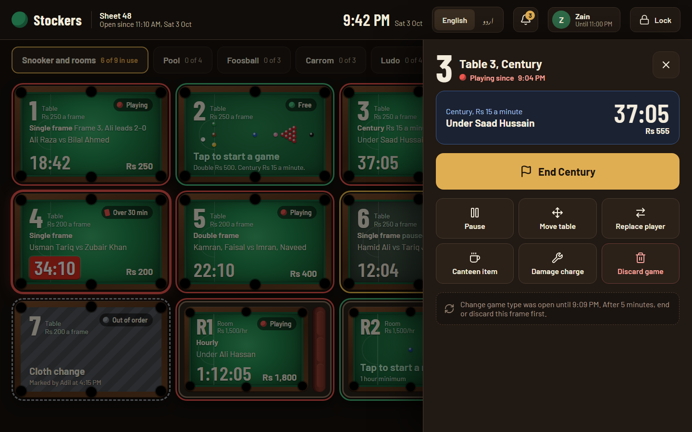

## 21. The panel in the first 5 minutes: Change game type

- **What:** screen 11 shows a dashed note once the 5 minutes are over ("Change game type was open until 9:28 PM"). Inside the 5
  minutes the note is replaced by a button, "Change game type", with the minutes left beside it. It opens screen 12. Only snooker
  tables have it (the other games have one kind of game).
- **Where:** `/table/t2?scenario=newGame` at 9:53 PM.
- **Words:** "Change game type", "2 minutes left to change", "1 minute left to change".
- **Built from:** screen 11 and the outline button of screen 7.

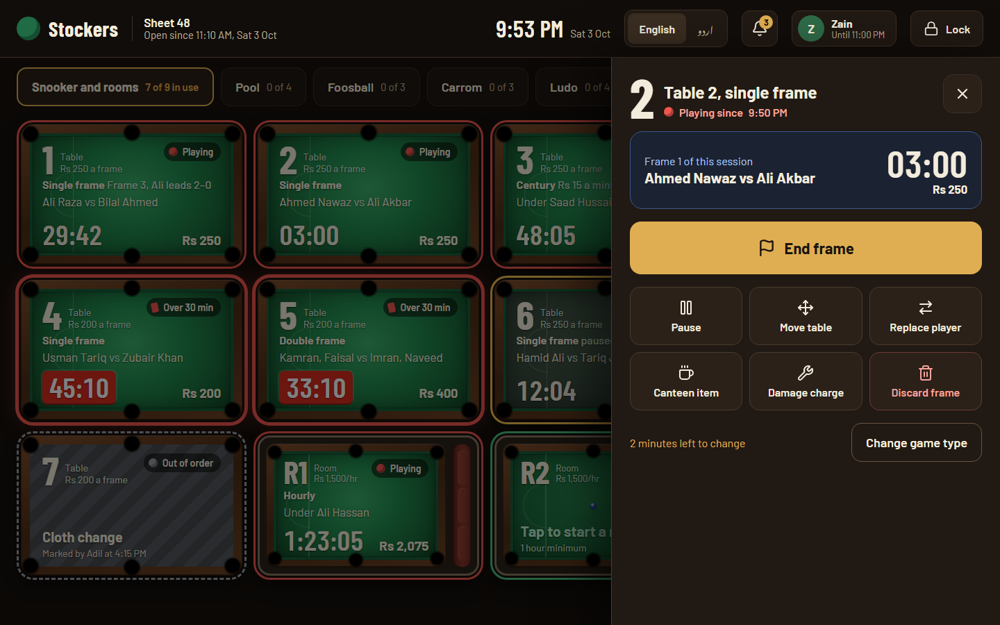

## 22. Move a room, and the players to pick from

- **What:** a game moves only to a free table of the same kind, so a room is offered the other rooms and a snooker table the other
  snooker tables. With nothing typed, "Who is coming in?" offers the four players who played here lately (never the ones already in
  the game), so a replacement can be picked with one tap. If there is no other table, the panel says so.
- **Where:** `/table/r1/move`.
- **Words:** "Move Room 1 to another table", "Rs 1,500/hr, same price", "There is no other table of this kind to move to." and the
  words of screen 13.
- **Built from:** screen 13.

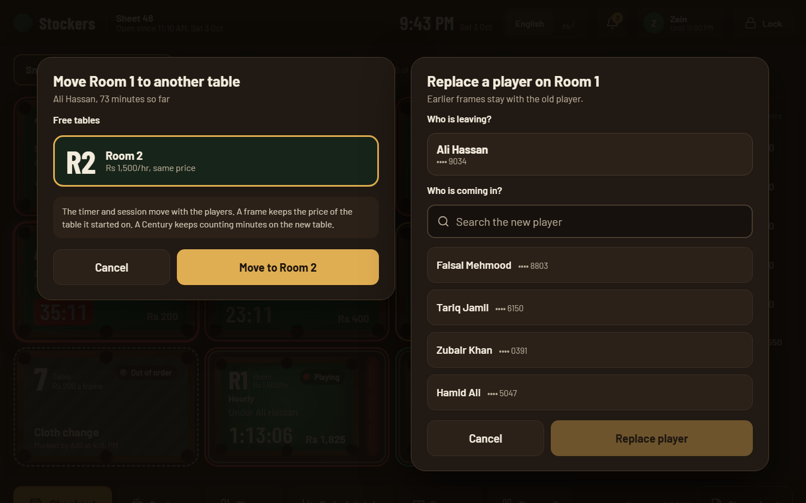

## 23. Stop a frame: the dispute and the cancel

- **What:** screen 14 draws Discard frame picked. The other two choices use the same dialog. The button says what will happen:
  "Discard frame" (or "Discard game" for a Century, a room or a game), "Mark as dispute", "Cancel game". A reason is always asked
  for; the note is optional. What is written for the owners is the reason in English whatever language the counter is in, with the
  note after it. A dispute and a cancel are sent as one text: the reason, then the note. **Exception, answered on 17 Oct 2026:** "Cancel,
  started by mistake" in the first 2 minutes of the worker's own game acts exactly like Undo: no reason is asked, nothing is charged,
  and Activity shows "Game undone". The card says "Wrong table or wrong players. In the first 2 minutes it works like Undo: no reason,
  nothing charged." and the dialog says "Started less than 2 minutes ago, so this works like Undo: no reason is needed and nothing is
  charged." After 2 minutes, or on another worker's game, a reason is asked as before.
- **Where:** `/table/t6/stop`, pick "Unpaid, dispute".
- **Words:** "Mark as dispute", "Cancel game", "Discard game".
- **Built from:** screen 14.

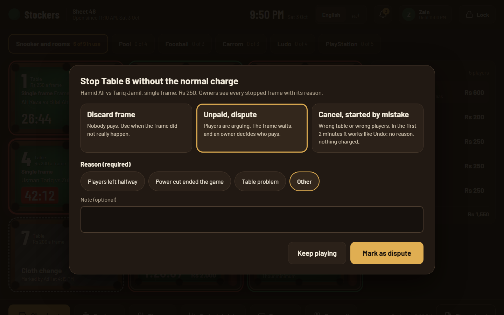

## 24. Damage charge: nothing picked yet

- **What:** screen 15 draws Ali, Cue and Rs 1,500 already picked. It is money, so the dialog starts with nothing picked (who pays,
  what was damaged, the amount, the note); the button says "Add to the bill" and stays off until all four are filled in, and then says
  what it will do ("Add Rs 1,500 to Ali’s bill"). A Century has one player, so he is the only one offered. Approved by the developer on
  17 Oct 2026; the visual test leaves the picked state out of the comparison.
- **Where:** `/table/t1/damage`.
- **Words:** "Add to the bill", "Shows on the player’s statement as a damage charge. Owners see it in Activity."
- **Built from:** screen 15.

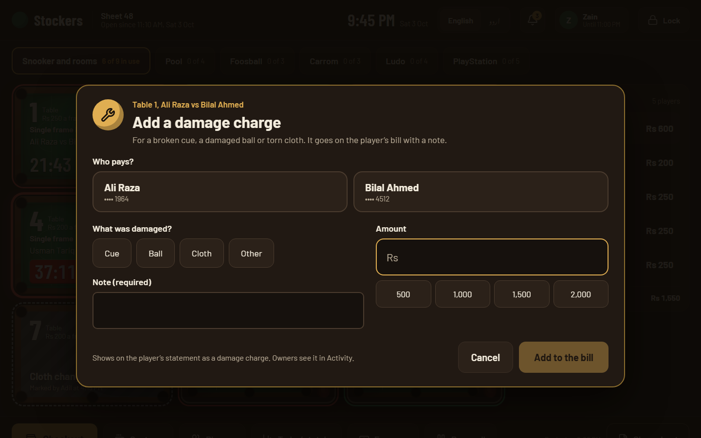

## 25. Undo done

- **What:** after "Undo" on the toast of screen 14, the toast says what happened for four seconds, then goes. The table is free again
  and the owners see the undo in Activity with the worker's name (D16). A worker can undo only his own game: the toast shows only the
  game he started, and the server refuses another worker's undo (answered on 17 Oct 2026).
- **Where:** any counter screen within 2 minutes of starting a game, for example `/?scenario=newGame` at 9:50:18 PM, then Undo.
- **Words:** "Game undone on Table 2."
- **Built from:** the toast of screen 14.

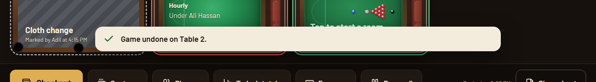

## 26. Pause all from the action bar

- **What:** the "Pause all" button pauses every running game at once and the board becomes the power-cut board of screen 16. While
  it is on, the button is off (there is nothing left to pause); "Resume all games" on the banner is the way back. Tiles that were
  paused one by one show "paused 3 min ago" as before; after Pause all they show the Resume button of screen 16.
- **Where:** `/`, then "Pause all" in the action bar.
- **Words:** the words of screen 16.
- **Built from:** screen 16.

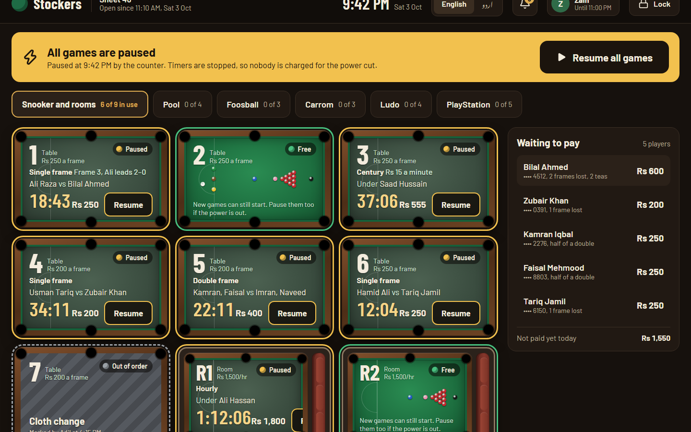

## 27. Put a table back in order

- **What:** a tap on a grey table opens a dialog. If a **worker** marked the table, another worker (or the same one) can put it back
  with a short note: the dialog has a note box and "Put back in order", which stays off until the note is written. Both the marking
  and the putting back are written in Activity with the worker's name. Answered by the developer on 17 Oct 2026. A table that is not
  grey has nothing to put back, and a grey table's `/start` address opens this dialog.
- **Where:** mark Table 2 out of order from `/table/t2/start`, then tap the grey tile.
- **Words:** "Table 2 is out of order" with the note and "Marked by Zain at 9:42 PM", "Note (required)", "Write what was done, for
  example “Cloth changed”. Everyone sees it.", "Put back in order", "Cancel". Urdu: see `docs/URDU_TO_CHECK.md`.
- **Built from:** the dialog of screen 7 with the round brass ball and wrench of screen 15, and the note box of section 13.

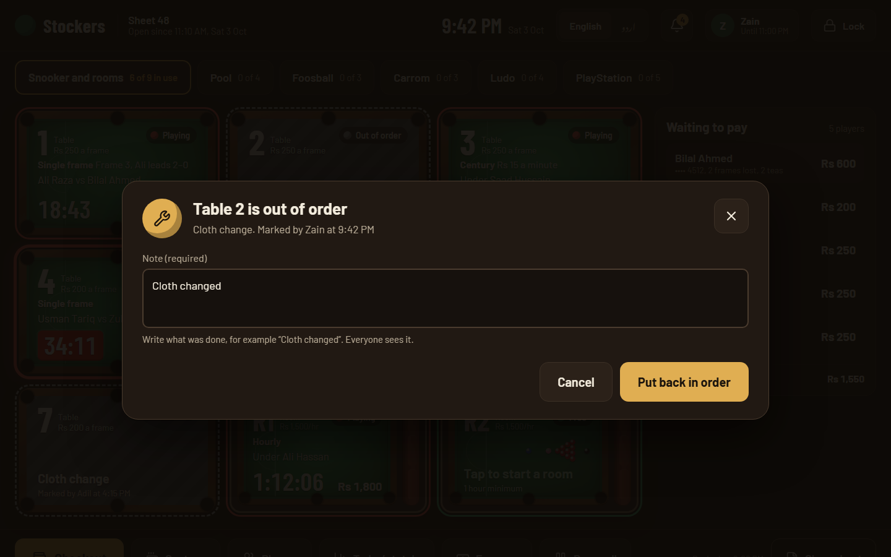

## 28. A table an owner marked

- **What:** the same dialog for a table an **owner** marked (Adil on Table 7): it says who marked it and that only an owner can put it
  back (in Games and prices). It has no note box and no put-back button; the server refuses a worker's call as well.
- **Where:** `/table/t7/back-in-order`, or tap the grey Table 7.
- **Words:** "Table 7 is out of order" with "Cloth change. Marked by Adil at 4:15 PM", "Adil marked this table. Only an owner can put
  it back.", "Cancel". Urdu: see `docs/URDU_TO_CHECK.md`.
- **Built from:** section 27.

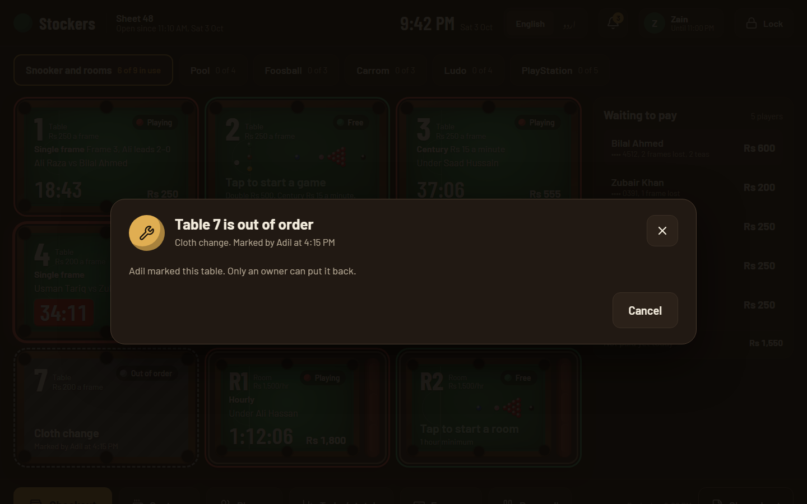

## 29. Which side lost: one pays all, and a custom split

- **What:** screen 20 draws Side B picked with "Half each". Before a side is chosen there is no split box and the brass button says
  "Choose the side that lost" and stays off. After it, the split box offers three choices. **Half each** shows what each pays as
  words. **One pays all** makes each player's row a button: the one tapped pays the whole price ("Charge Naveed") and the other pays
  nothing. **Custom** makes the two amounts fields; typing in one sets the other to what is left, so they always add up to the price
  (the server refuses a split that does not, D9). **Nobody is picked until the worker taps who pays** (answered 17 Oct 2026, D65:
  the same rule as damage and discount): the button says "Choose who pays" and stays off, and neither row is marked. Switching to
  Half each or Custom and back clears the choice. A side with one player has no split to choose: he pays all of it.
- **Where:** `/table/t5/end?now=2026-10-03T21:47:00%2B05:00`, tap "Side B", then "One pays all".
- **Words:** "Choose the side that lost", "One pays all", "Choose who pays", "Naveed pays", "Charge Naveed", "The amounts add up to Rs 390, not Rs 400."
- **Built from:** screen 20.

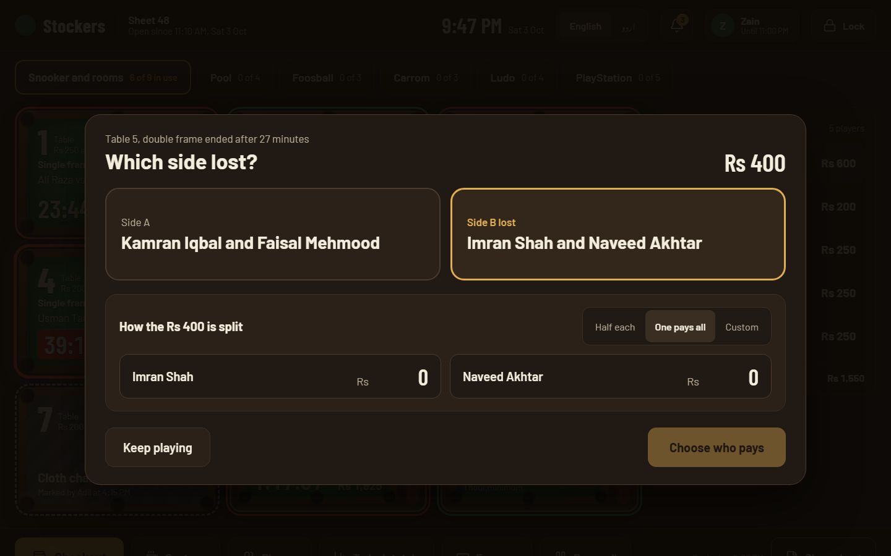

## 30. Charge double? for a double frame

- **What:** the over-the-limit question (screen 19) is also asked for a double frame (Q2, `docs/11` 15). It comes after the side and
  the split, because the split is the worker's, and before anything is charged. The question names the two sides ("Imran Shah and
  Naveed Akhtar lost to Kamran Iqbal and Faisal Mehmood. Choose what they pay.") and offers the whole price (Rs 400) or double
  (Rs 800). A custom split doubles with it, so it still adds up (300 + 100 becomes 600 + 200).
- **Where:** `/table/t5/end?now=2026-10-03T22:00:00%2B05:00`, tap "Side B", then "Charge Imran and Naveed".
- **Words:** "This frame took 40 minutes. Charge double?", "Choose what they pay."
- **Built from:** screen 19.

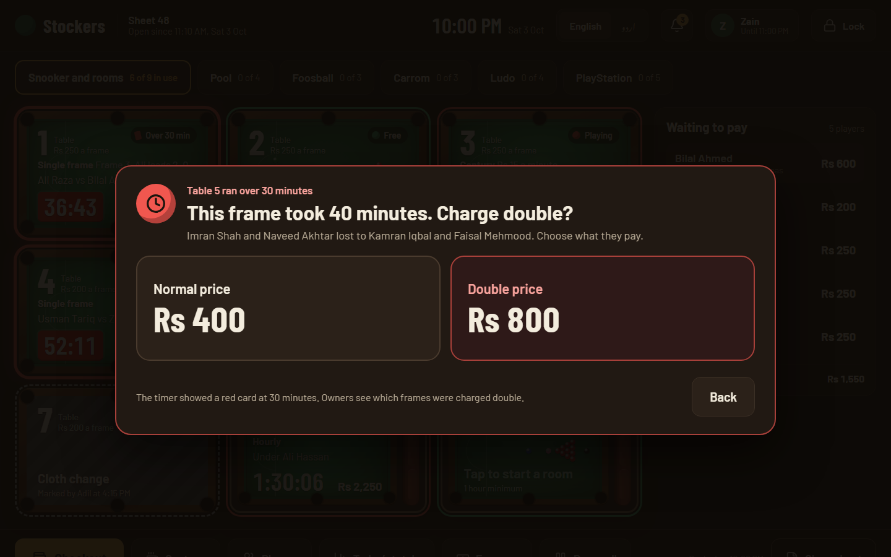

## 31. Start a room: nobody picked yet

- **What:** screen 22 draws Danish Iqbal already picked. Before anybody is, "Under" holds the player search of screen 8 (with "Add
  as a new player"), and "Start Room 2" stays off. Picking a player shows the green card of the screen with "Change", which takes
  him off again.
- **Where:** `/room/r2/start?now=2026-10-03T21:52:00%2B05:00`.
- **Words:** "Search the player the room is under" (the name of the box).
- **Built from:** screens 8 and 22.

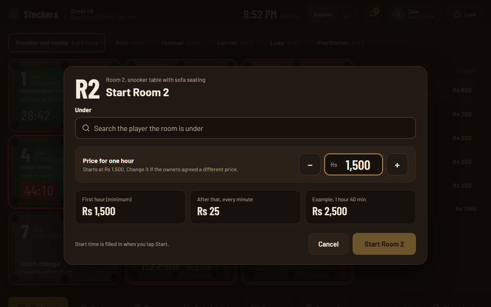

## 32. Undo on the next-frame screen

- **What:** screen 18 draws "Tapped the wrong player? Undo, 1:56 left" and no document said what it does. **Answered 17 Oct 2026
  (D63):** it asks "Who lost this frame?" again, for the frame that was just charged. Tapping the right player takes the first charge
  off (the line on the first player's statement, his numbers, the session score and the sheet's totals) and puts it on the other
  player; "Nobody pays" is the Discard with a reason (§40). Nothing is changed until he picks, so "Keep it as it is" and walking
  away leave the first charge. Only the worker who charged the frame can do it, for 2 minutes, **also after Next frame has started**:
  it changes only the finished frame and never touches the running one (§42 is the toast that offers it then). He has 2 minutes from
  tapping Undo to choose. A frame that ran over its limit asks "Charge double?" again, judged at the minute it ended. Activity shows
  "Frame undone on Table 1" with his name. A Century, a room or a double frame has no screen 18; it has the Undo toast instead (§53).
- **Where:** `/table/t1/end?now=2026-10-03T21:51:00%2B05:00`, tap Bilal Ahmed, then "Undo". The picture is the screen it opens.
- **Words:** "Undo, 1:56 left" (the words of screen 18); under the two cards "Rs 250 is on Bilal Ahmed’s bill now. Tap who lost, or keep
  it as it is."; the quiet button "Keep it as it is" (screen 17 says "Keep playing").
- **Built from:** screens 17 and 18.

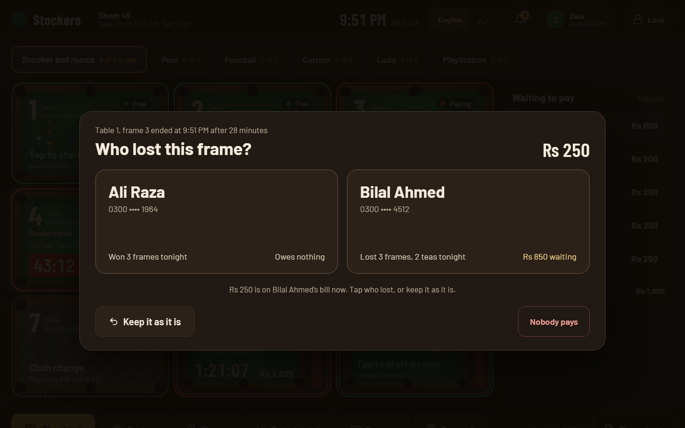

## 33. After a payment: the note on the checkout list

- **What:** after a bill is paid (Paid in full, Paid part or Put all on credit) the worker is taken back to the list, and a green
  note at the top says what was done: who paid, how much, and what stays as credit or is kept as advance. The bill is gone from
  "Waiting to pay" and the count and "Waiting tonight" have gone down. The note stays until the worker leaves the page.
- **Where:** `/checkout?scenario=checkout&now=2026-10-03T22:20:00%2B05:00`, tap Saad Hussain, then "Paid in full" and Yes (§39). The
  owners kept this note on 17 Oct 2026 (D63).
- **Words:** "Saad Hussain paid Rs 430." and, when something is left, "Rs 300 stays as credit." or "Rs 150 is kept as advance."
- **Built from:** the green box of screens 1 and 26.

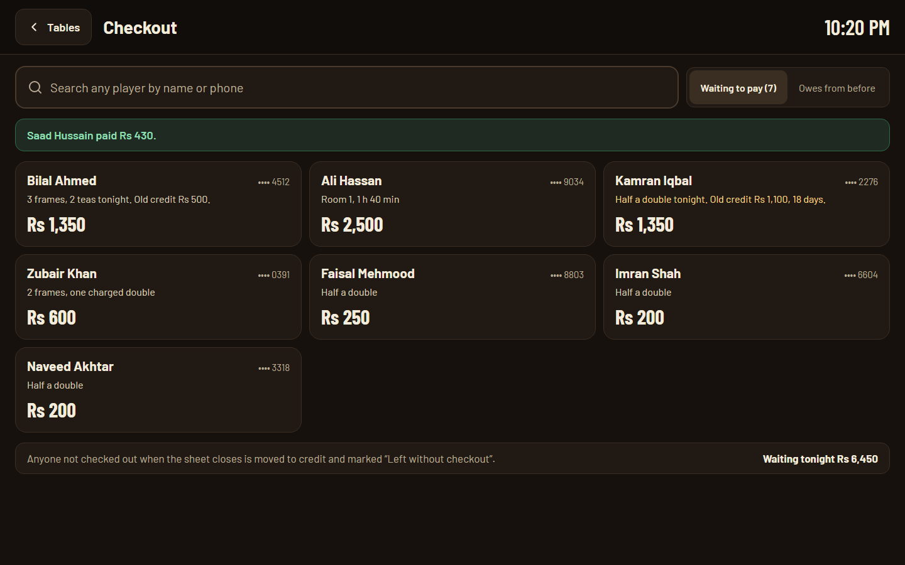

## 34. Checkout: Owes from before

- **What:** the second tab of screen 24 ("Owes from before") has no PNG. It lists everyone with old credit as the same cards: first
  the bills waiting tonight that have old credit, then the other players who owe, oldest first. A card says "Owes Rs 950 from
  before", with the age in amber when it is more than 15 days, and the amount he owes. A tap opens his bill, where he can pay it.
- **Where:** `/checkout?scenario=checkout&now=2026-10-03T22:20:00%2B05:00`, tap "Owes from before".
- **Words:** "Owes from before", "Owes {{amount}} from before, {{days}} days", "Nobody owes from before." when the list is empty.
- **Built from:** the cards of screen 24.

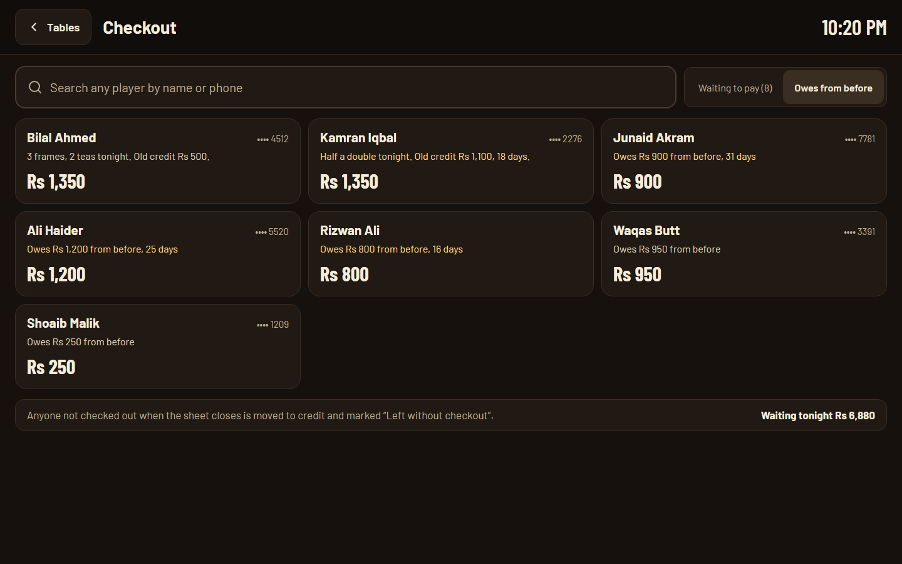

## 35. Checkout: search any player

- **What:** typing in "Search any player by name or phone" replaces the cards with the players found (names that start with the
  text first), whether or not they have a bill tonight. A player with no bill shows what he owes, or what he holds in advance. A tap
  opens his bill, which for a player with only old credit has no lines for tonight.
- **Where:** `/checkout?scenario=checkout&now=2026-10-03T22:20:00%2B05:00`, type "waq".
- **Words:** "No player found." when nothing matches.
- **Built from:** the cards of screen 24 and the search box of screen 8.

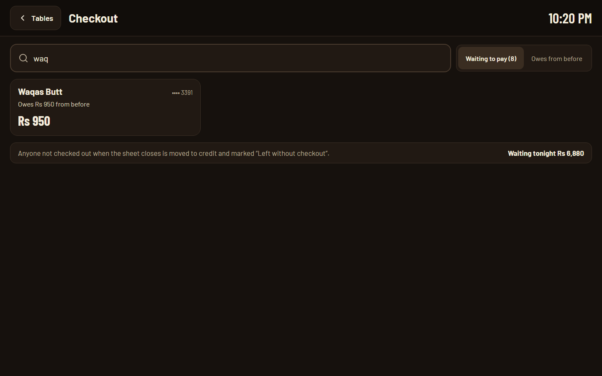

## 36. A bill that uses an advance

- **What:** screen 25 draws Bilal, who owes old credit. A player who holds an advance (Saad: Rs 200) gets a green box in the place of
  the amber one: "Advance held", "Used against tonight’s bill" and "− Rs 200". The total is the charges less the advance (Rs 630
  − Rs 200 = Rs 430). Nothing else on the page changes.
- **Where:** `/checkout/saad?scenario=checkout&now=2026-10-03T22:20:00%2B05:00`.
- **Words:** "Advance held", "Used against tonight’s bill".
- **Built from:** the old-credit box of screen 25 in the green of screen 26.

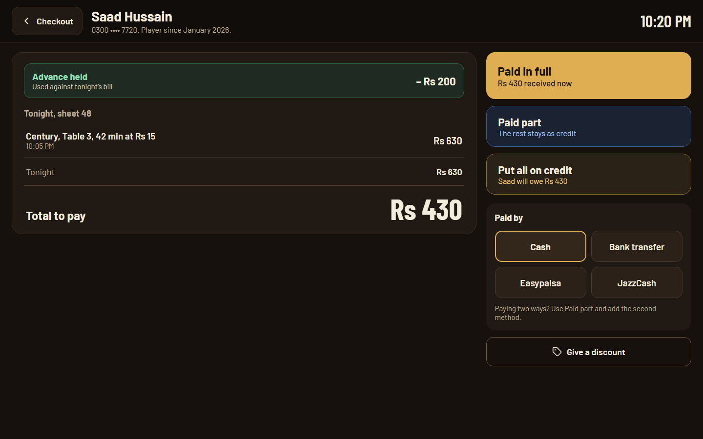

## 37. Part payment: paying more than the total

- **What:** screen 26 draws Rs 1,000 paid on a total of Rs 1,300, with Rs 300 staying as credit. When more is typed than the total
  the third box says "Kept as advance" with the extra in green, and the button says "Rs 150 is kept as advance" (D26). The note
  under the boxes already says so.
- **Where:** `/checkout/kamran/part?scenario=checkout&now=2026-10-03T22:20:00%2B05:00`, type 1500 on the keypad.
- **Words:** "Kept as advance", "{{amount}} is kept as advance".
- **Built from:** the boxes of screen 26.

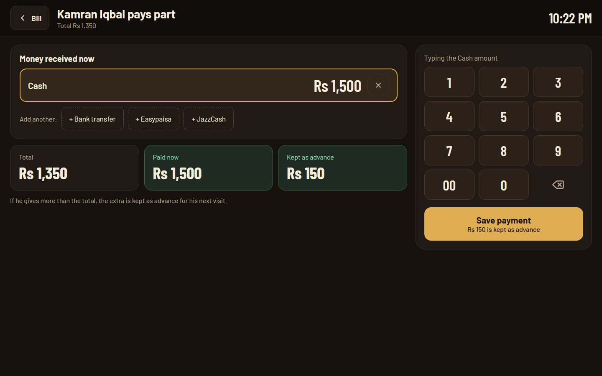

## 38. Give a discount: changing or removing it

- **What:** screen 27 draws the amount, the reason and the note already filled in. It is money, so the dialog starts empty (the
  button says "Apply discount" and stays off until the amount and a reason are given); "Apply Rs 50 discount" then says what it
  will do. A discount is kept with the checkout and saved with the payment, with the worker's name. Opening the dialog again shows
  the discount that was given, and a quiet "Remove discount" button takes it off. More than the bill is refused: "A discount cannot
  be more than the bill, Rs 1,350."
- **Where:** `/checkout/bilal?scenario=checkout&now=2026-10-03T22:20:00%2B05:00`, "Give a discount", Rs 50, "Rounded the bill", Apply,
  then "Give a discount" again.
- **Words:** "Apply discount", "Remove discount", "A discount cannot be more than the bill, {{total}}."
- **Built from:** screen 27.

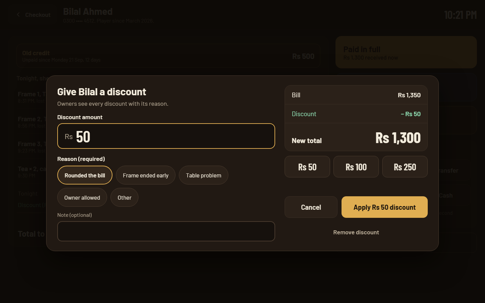

## 39. Money actions ask once: the confirm sheet

- **What:** the owners were promised that money actions ask once. Paid in full, Put all on credit and Save payment (a part payment)
  each open a sheet before anything is saved. It says the amount and the method in one sentence, with a big **Yes** and a big
  **No**. Yes saves the payment with the worker's name and goes back to the list with the green note (§33); No (or Escape) closes the
  sheet and nothing is saved. The discount is part of the same payment, so it is saved on Yes and dropped with the checkout otherwise.
- **Where:** `/checkout/bilal/part?scenario=checkout&now=2026-10-03T22:22:00%2B05:00`: type 600 in Cash, add Easypaisa and type 400,
  then "Save payment". Paid in full and Put all on credit ask the same way on `/checkout/bilal`.
- **Words:** "Rs 1,000 paid: Cash 600, Easypaisa 400, Rs 350 to credit?" (with an advance: ", Rs 150 kept as advance"), "Put Rs 1,350 on
  Bilal Ahmed’s credit?", "Bilal Ahmed has nothing to pay. Save it?", "Bilal Ahmed. You can undo it for 2 minutes.", "Yes", "No".
- **Built from:** the dialog of screen 27 and the brass button of screen 25.

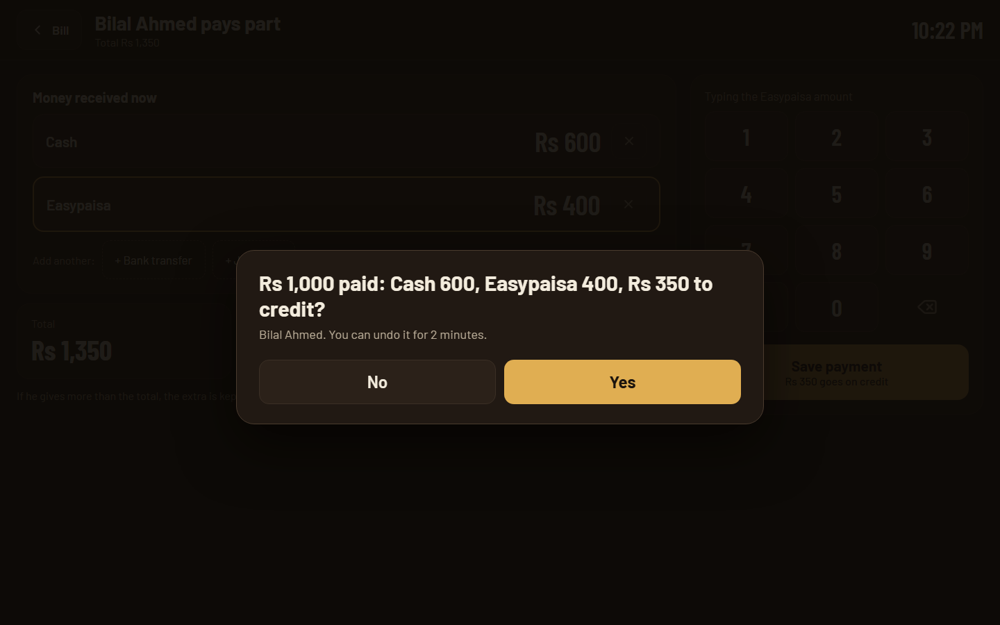

## 40. Undo after a charged frame: Nobody pays

- **What:** "Nobody pays" on the "Who lost this frame?" that Undo opens (§32) is a Discard with a required reason, the same five reasons
  and the optional note as the stop screen (14). The first charge is taken off, the frame is recorded as discarded, and Activity shows
  "Frame undone on Table 1" and "Frame discarded on Table 1" with the worker's name and the reason.
- **Where:** `/table/t1/end?now=2026-10-03T21:51:00%2B05:00`, tap Bilal Ahmed, then "Undo", then "Nobody pays".
- **Words:** "Nobody pays for this frame", "Rs 250 is taken off Bilal Ahmed’s bill. Choose why, so the owners can see it.", "Reason
  (required)", the reasons of screen 14, "Note (optional)", "Nobody pays", "Keep it as it is".
- **Built from:** screens 14 and 17.

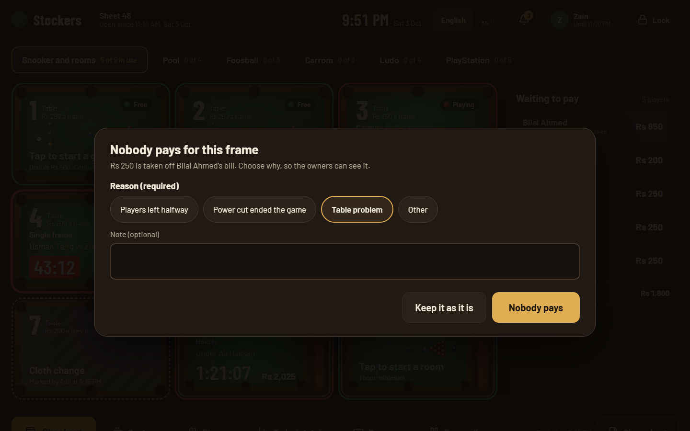

## 41. The Undo toast after a payment

- **What:** after a payment is saved (Yes on the sheet of §39) the cream Undo toast of the games appears for 2 minutes, for the worker
  who took the payment only, on any screen and after a reload. Undo takes the payment back: the bill is waiting again in the same
  place, the drawer and the online money lose the amount, and Activity shows "Payment undone for Bilal Ahmed". After Undo the toast
  says "Payment undone for Bilal Ahmed." for a moment.
- **Where:** `/checkout/bilal?scenario=checkout&now=2026-10-03T22:20:00%2B05:00`, "Paid in full", Yes.
- **Words:** "Payment saved: Bilal Ahmed paid Rs 1,350.", "Rs 350 stays as credit." (when something is left), "Put on credit: Bilal
  Ahmed’s bill." (when nothing was paid), "Undo for 1:50 more", "Undo", "Payment undone for Bilal Ahmed."
- **Built from:** the toast of screen 14 (§25).

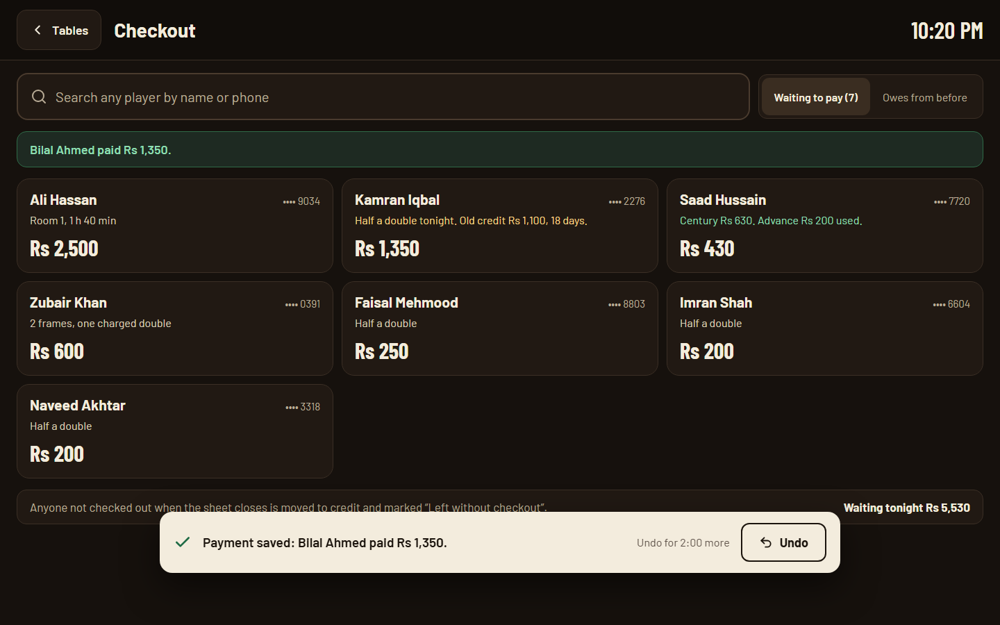

## 42. The Undo toast after a charged frame

- **What:** after screen 18 has gone (Next frame, Free the table, Change players), the same cream toast keeps the Undo of the charged
  frame for the 2 minutes. It sits under the toast of the new frame when there is one. Undo opens "Who lost this frame?" again (§32).
  It is not shown on screen 18 itself, which has its own Undo button, or while the correction is open.
- **Where:** `/table/t1/end?now=2026-10-03T21:51:00%2B05:00`, tap Bilal Ahmed, then "Next frame, same players".
- **Words:** "Rs 250 added to Bilal Ahmed’s bill", the table name beside it, "Undo for 1:59 more", "Undo".
- **Built from:** the toast of screen 14 (§25) and the title of screen 18.

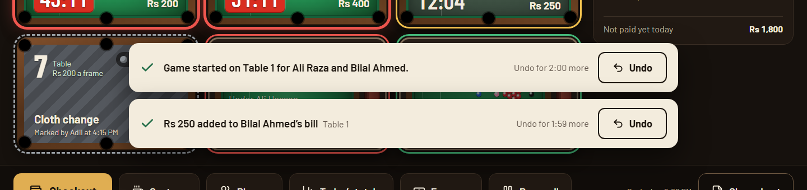

## 43. Canteen: nobody picked yet

- **What:** screen 28 draws a player already picked (Usman Tariq, with "Change"). A real page opens with nobody picked: under "Charge to"
  the player search of screens 8 and 9 (type a name or the last digits of a phone, tap the player), with "Add “Ali” as a new
  player" as its last row. Until a player is picked the big button says "Pick a player first" and is off; with an empty order it says
  "Add something first". The order says "Tap an item to add it to the order." A player who is picked shows his masked phone and one
  plain line: where he is playing, or what he owes.
- **Where:** `/canteen?now=2026-10-03T21:55:00%2B05:00`, tap Biscuits.
- **Words:** "Search by name or phone", "Pick a player first", "Add something first", "Tap an item to add it to the order.", "{{tail}},
  playing on Table 4", "{{tail}}, owes Rs 600", "Rs 300 added to Usman Tariq’s bill." (the note after a sale, §46's pattern).
- **Built from:** screens 8 (player search) and 28.

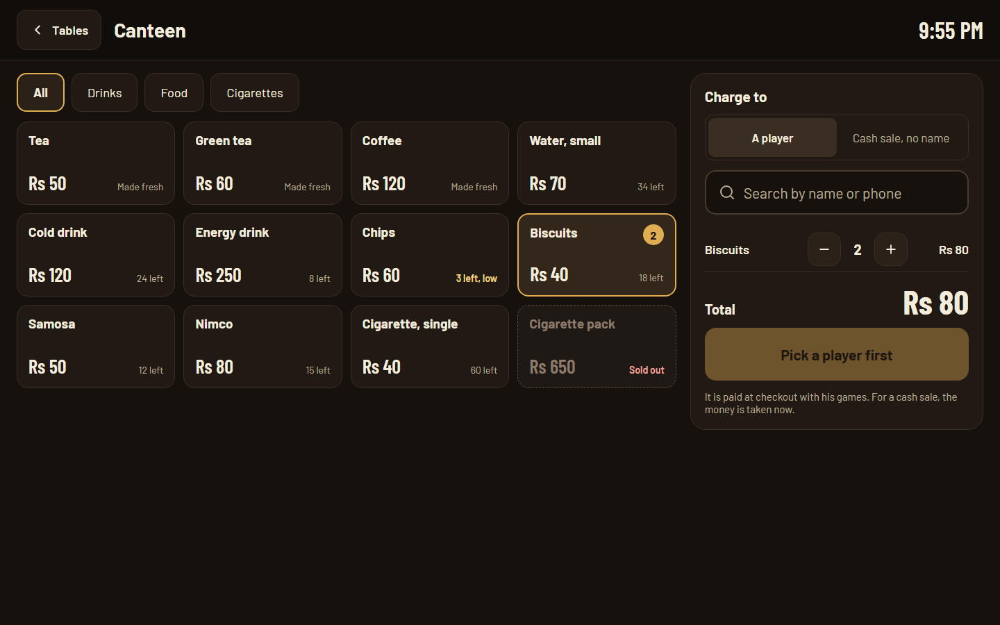

## 44. Canteen: a cash sale

- **What:** screen 28 draws only the player half of "Charge to". With "Cash sale, no name" (Q10) the player card is replaced by the
  payment methods the owners have on ("Money taken now": Cash, Bank transfer, Easypaisa, JazzCash, Cash first), and the big button
  takes the money now: "Take Rs 120 now (Easypaisa)". The money goes in the drawer (cash) or the online totals, the sale has no name,
  and the order is empty again for the next customer. It asks nothing; the cream Undo toast of §54 keeps it for 2 minutes
  (answered 17 Oct 2026, D65).
- **Where:** `/canteen?now=2026-10-03T21:55:00%2B05:00`, tap Coffee, then "Cash sale, no name" and Easypaisa.
- **Words:** "Money taken now", "Take Rs 120 now (Easypaisa)", "Rs 120 taken for the canteen, Easypaisa."
- **Built from:** the "Paid by" choices of screen 25 and screen 28.

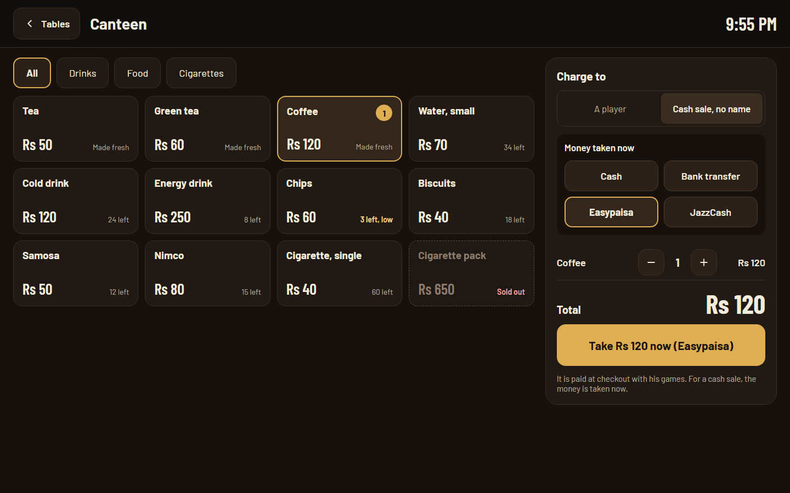

## 45. Expense from the drawer: nothing picked yet

- **What:** screen 29 draws Food, a note and Rs 500 already chosen. A real dialog opens with nothing chosen for the worker (money:
  the same as the damage charge): no kind, an empty note and amount, and "Take cash from the drawer" off until a kind, a note and an
  amount above 0 are given. "Cash in the drawer" shows what the drawer should have now; once an amount is given it shows
  "Rs 17,950" struck through and the new figure beside it.
- **Where:** `/expense?now=2026-10-03T20:15:00%2B05:00` (or the action bar's Expense).
- **Words:** "Take cash from the drawer" (while the button is off), "Cash in the drawer". The accessible names of the two figures are
  "Now Rs 17,950" and "After Rs 17,450".
- **Built from:** screens 15 and 29.

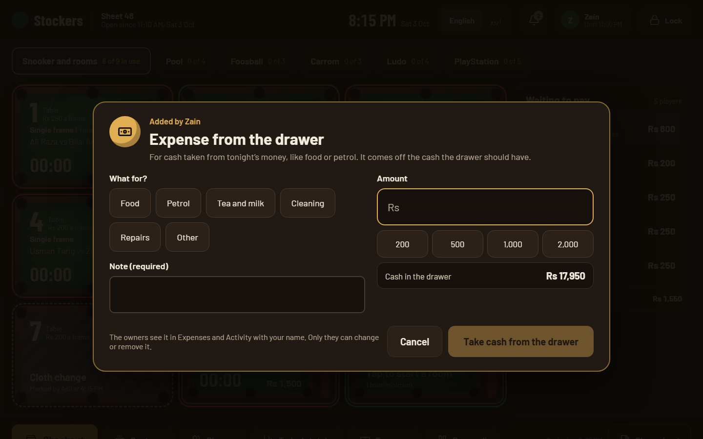

## 46. Expense from the drawer: the Undo toast after it is saved

- **What:** after "Yes" on the question of §55 the dialog closes and the cream toast says what was done, with "Undo for 1:59 more" and an
  Undo button for 2 minutes, for the worker who took the cash. It is saved with his name and the owners see it in Expenses
  (paid from "Drawer cash") and Activity (D53). Undo puts the cash back in the drawer: the expected cash goes back, the expense
  is removed, and Activity keeps the first line and adds "Expense from the drawer undone" with his name; the toast then says
  "Rs 500 put back in the drawer." for a moment. (Before 17 Oct 2026 this was a plain note for four seconds.)
- **Where:** `/?now=2026-10-03T20:15:00%2B05:00`, Expense, Food, a note, Rs 500, "Take Rs 500 from the drawer", Yes.
- **Words:** "Rs 500 taken from the drawer: Dinner for staff.", "Undo for 1:59 more", "Undo", "Rs 500 put back in the drawer."
- **Built from:** the cream toast of screen 14 (§25).

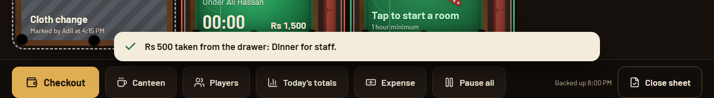

## 47. Players: nobody picked yet

- **What:** screen 30 draws Kamran Iqbal picked. `/players` has nobody picked: the list is on the left (All first, alphabetical) and the
  panel on the right says what to do. A search or a filter that finds nobody says "No player found."
- **Where:** `/players?now=2026-10-03T22:25:00%2B05:00`.
- **Words:** "Pick a player on the left to see his account.", "No player found.", "Nothing in this period." (a period with no lines).
- **Built from:** screen 30.

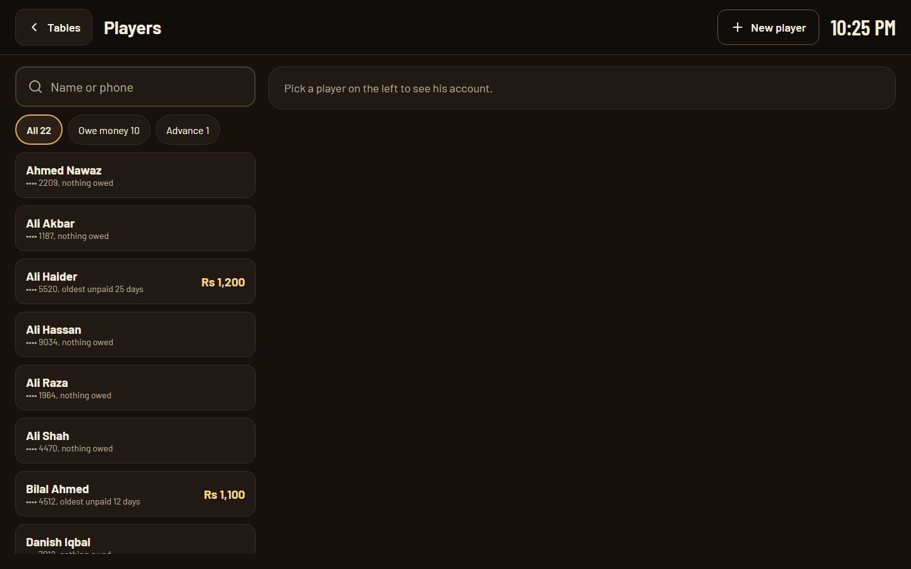

## 48. Players: Advance

- **What:** screen 30 draws the "Owe money" list only. In the **Advance** list (players the club holds money for) the amount at the end
  of a row is green, the line says "advance", and his account says "Advance with the club" in green above the amount; a player who
  owes nothing says "Nothing owed". The list is the biggest advance first; "Owe money" is the most owed first; "All" is alphabetical.
- **Where:** `/players/saad?now=2026-10-03T22:25:00%2B05:00`, tap Advance.
- **Words:** "{{tail}}, advance", "Advance with the club", "Nothing owed", "{{tail}}, nothing owed", "{{tail}}, since tonight".
- **Built from:** screen 30 and the green box of screen 25 (Advance held).

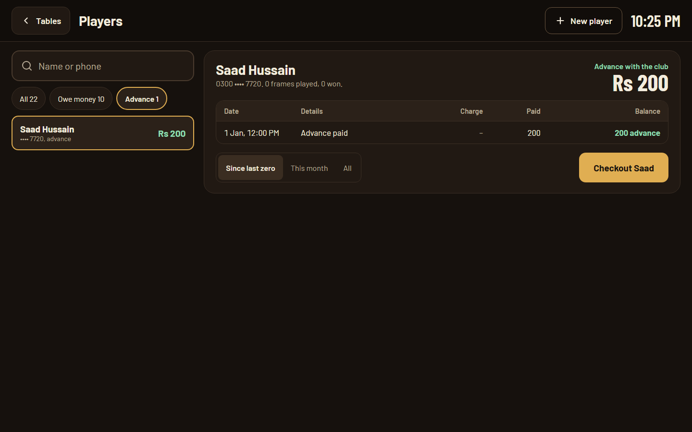

## 49. Today’s totals: nobody waiting to pay

- **What:** the line of screen 31 about the bills still waiting ("Still waiting to pay: 6 bills, Rs 5,100. Ask them before they leave.")
  says "Nobody is waiting to pay." when there is nothing waiting, and "Go to checkout" stays. The line about the drawer expenses
  says the total and the last one when there is more than one ("Expenses from the drawer tonight: Rs 1,000. The last one: Gas
  cylinder (Zain, 9:55 PM). …"), and "No expenses from the drawer tonight." when there are none.
- **Where:** `/today?scenario=empty&now=2026-10-03T22:30:00%2B05:00`.
- **Words:** "Nobody is waiting to pay.", "Expenses from the drawer tonight: {{amount}}. The last one: {{what}} ({{who}}, {{time}}). Profit is
  shown to the owners only.", "No expenses from the drawer tonight. Profit is shown to the owners only."
- **Built from:** screen 31.

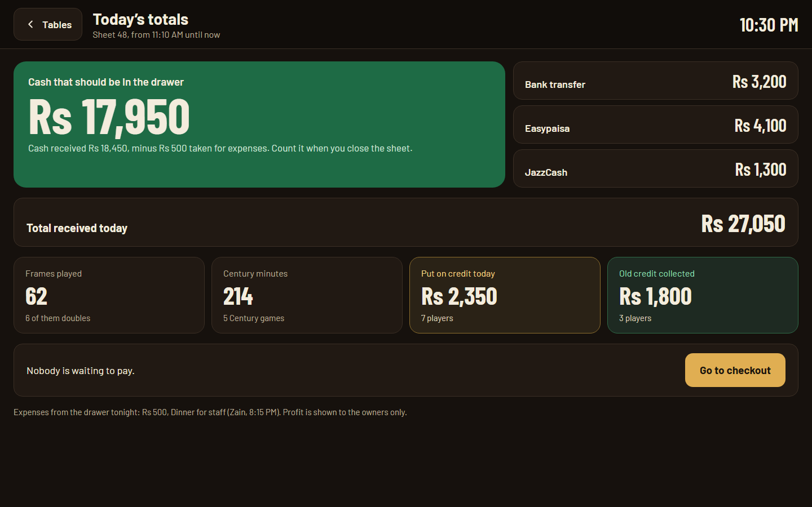

## 50. Close sheet: a note is needed

- **What:** screen 32 draws the cash counted (Rs 21,550) and "Short Rs 200" with the note written. Before the count the third box says
  "Difference" with a dash; when the cash is **extra** it is green ("Extra Rs 50"); when it matches it says "Cash matches" with Rs 0 and
  needs no note. While a note is needed and empty, "Close sheet 48" is off and a line under it says "Write a note about the
  difference before you close." (amber).
- **Where:** `/close-sheet?scenario=closing&now=2026-10-04T03:40:00%2B05:00`, count 21,800.
- **Words:** "Difference", "Extra", "Cash matches", "Count the cash" (the empty box), "Write a note about the difference before you close."
- **Built from:** screen 32 (the red "Short" box in green).

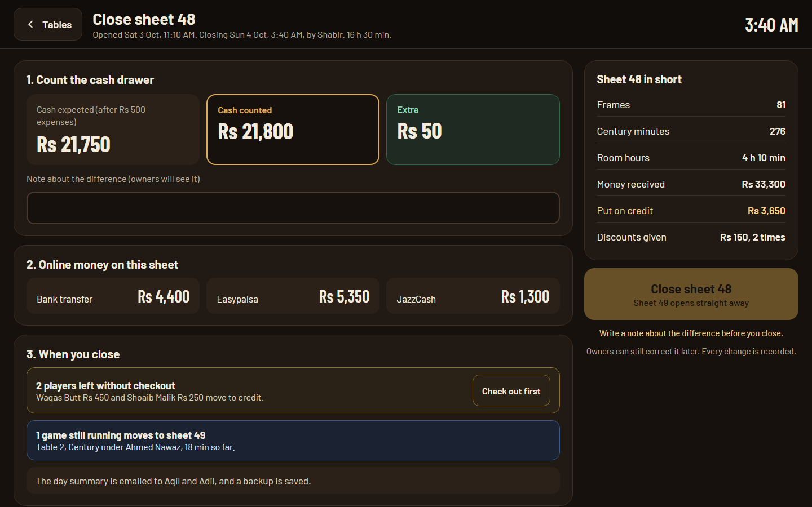

## 51. Close sheet: the confirm sheet

- **What:** "Close sheet 48" asks once before it closes (money actions ask once, D63). The sheet says how much was counted and
  whether the cash is short, extra or matches, how many players move to credit and how much, and how many games move to the next
  sheet, with a big **No** and a big **Yes, close it**. The owners approved it on 17 Oct 2026 (D65): money actions ask once, and
  closing moves bills to credit. No (or Escape) changes nothing.
- **Where:** `/close-sheet?scenario=closing&now=2026-10-04T03:40:00%2B05:00`, count 21,550, a note, "Close sheet 48".
- **Words:** "Close sheet 48 with Rs 21,550 counted?", "The cash is Rs 200 short.", "2 players left without checkout move to credit (Rs 700).",
  "1 game still running moves to sheet 49.", "Yes, close it", "No".
- **Built from:** the confirm sheet of §39.

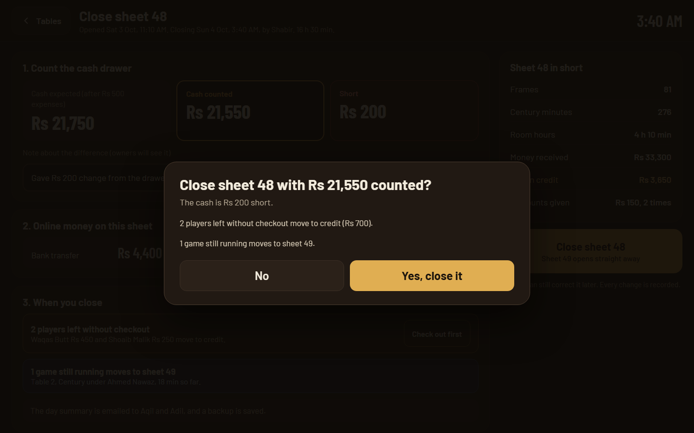

## 52. Sheet closed: nothing moved

- **What:** screen 33 draws a close with a game moved, two players moved to credit and Rs 200 short. When nothing was running the first
  card says "Nothing was running / Every table was free at the close"; when everybody was checked out the second says "Nobody /
  Everyone was checked out"; when the cash was exact the third says "Cash matches / Nothing short or extra". Several games moved say
  "3 games / Still running".
- **Where:** `/close-sheet?scenario=empty&as=shabir&now=2026-10-04T03:40:00%2B05:00`, count 17,950, close.
- **Words:** "Nothing was running", "Every table was free at the close", "Nobody", "Everyone was checked out", "Cash matches", "Nothing short or
  extra", "{{count}} games", "Still running", "{{table}}, single frame".
- **Built from:** screen 33.

## 53. The Undo toast after a double, a game, a Century or a room

- **What:** a frame that is charged has screen 18 with its Undo. A double frame, a game of pool and the others, a Century and a room go
  back to the board when they end (D61), and now each leaves the same cream 2-minute Undo toast, for the worker who ended it
  (answered 17 Oct 2026, D65). It says what was charged ("Rs 630 added to Saad Hussain’s bill", the table's name beside it, or
  "Rs 400 charged to Imran Shah and Naveed Akhtar" for a double), "Undo for 1:59 more" and an Undo button. **Undo of a double or a
  game** asks who lost again (§32). **Undo of a Century or a room** has nobody to choose: it takes the charge off the bill and the
  game runs again where it stopped, and the time since it ended does not count; it needs the table to be free still. The toast
  then says "Century on Table 3 is running again." or "Room 1 is running again." for a moment. DEFAULT, needs answer: what Undo does for a
  Century and a room (the owners asked for the toast, not for what it does).
- **Where:** `/table/t3/end?now=2026-10-03T21:47:30%2B05:00`, "End and charge Rs 630".
- **Words:** "Rs 630 added to Saad Hussain’s bill", "Rs 400 charged to Imran Shah and Naveed Akhtar", "Undo for 1:59 more", "Undo",
  "Century on Table 3 is running again.", "Room 1 is running again."
- **Built from:** the toast of §42.

## 54. The Undo toast after a canteen sale

- **What:** "Add Rs 300 to Usman’s bill" and "Take Rs 120 now" ask nothing (answered 17 Oct 2026, D65), but the cream 2-minute Undo
  toast keeps them: "Rs 300 added to Usman Tariq’s bill." or "Rs 120 taken for the canteen, Easypaisa.", "Undo for 1:59 more" and
  Undo. Undo puts the items back in stock, takes the lines off his bill (or the money out of the drawer or the online totals) and
  writes "Canteen sale undone" in Activity with the worker's name; the toast then says "Canteen sale undone." (This replaces the
  four-second note of §43 and §44.)
- **Where:** `/canteen?now=2026-10-03T21:55:00%2B05:00`, search "usman", tap Cold drink twice and Chips, "Add Rs 300 to Usman’s bill".
- **Words:** "Rs 300 added to Usman Tariq’s bill.", "Rs 120 taken for the canteen, Easypaisa.", "Undo for 1:59 more", "Undo", "Canteen sale undone."
- **Built from:** the toast of §42.

## 55. Expense from the drawer: it asks once

- **What:** "Take Rs 500 from the drawer" opens a sheet before anything is saved (money actions ask once; answered 17 Oct 2026, D65). It
  says the amount and what for in one sentence and repeats the note, with a big **Yes** and a big **No**. Yes saves it and shows the
  toast of §46; No (or Escape) goes back to the form with everything still typed, and nothing is saved.
- **Where:** `/expense?now=2026-10-03T20:15:00%2B05:00`, Food, a note, Rs 500, "Take Rs 500 from the drawer".
- **Words:** "Take Rs 500 from the drawer for Food?", "“Dinner for staff”. You can undo it for 2 minutes.", "Yes", "No".
- **Built from:** the confirm sheet of §39.

## 56. Start a room: the price of an hour has a range

- **What:** screen 22 draws Rs 1,500 and the + and − buttons. The price is whole rupees from Rs 100 to Rs 10,000 (answered 17 Oct 2026,
  D65). The buttons stop at both ends. A price typed outside the range (or left empty) shows a red line under the price, and
  "Start Room 2" stays off until it is right. The three boxes under it keep the owners' price while the typed one is wrong.
- **Where:** `/room/r2/start?now=2026-10-03T21:52:00%2B05:00`, type 50 in "Price for one hour".
- **Words:** "The price of an hour is from Rs 100 to Rs 10,000."
- **Built from:** the red lines of screens 25 and 26.

## 57. Owner sign-in: a wrong password

- **What:** screens 35 and 52 draw the page with the password typed. After a wrong password (the field is empty or the server says no)
  a red line under the field says so, the field's border turns red, and the page stays. The words are the counter's PIN page words
  (§5) for a password.
- **Where:** `/owner-dev/sign-in?as=none&now=2026-10-03T22:30:00%2B05:00`, tap "Sign in" with nothing typed.
- **Words:** "Wrong password. Try again."
- **Built from:** the red line of the PIN page (§5) and the field of screen 35.

## 58. Owner sign-in: wait 15 minutes

- **What:** after 5 wrong tries in a row the red line says to wait and the "Sign in" button stays off until the time is up (the same 15
  minutes the note under the button says). The minutes shown count down.
- **Where:** `/owner-dev/sign-in?as=none&now=2026-10-03T22:30:00%2B05:00`, tap "Sign in" five times with nothing typed.
- **Words:** "Too many tries. Wait 15 minutes."
- **Built from:** §6 ("Wait 5 minutes" on the counter's PIN page).

## 59. Owner sidebar: Sign out

- **What:** no approved screen draws a way to sign out. A small icon button sits at the end of the owner's name in the walnut block at
  the bottom of the sidebar (it does not make the block taller). It signs the owner out and goes back to the sign-in page at the
  same address. On a phone it is a button in the More sheet (§60).
- **Where:** `/owner-dev/live?now=2026-10-03T22:30:00%2B05:00`, the bottom of the sidebar.
- **Words:** "Sign out" (the name of the button; it has no visible text on a computer).
- **Built from:** the owner block of screen 36 and the icon buttons of screen 36.

## 60. Owner phone: the More sheet

- **What:** the fifth tab of the phone's bottom bar (screen 53) is "More". It opens a bottom sheet with the pages the tab bar does not
  have, in the sidebar's order, then the language pills of screen 52 and a "Sign out" button. DEFAULT, needs answer: the sheet also lists
  **Reports** (seven pages), because Reports is not a tab and no phone screen draws it (the owners' list was Prices, Canteen, Expenses,
  Activity, Workers and Settings). While one of these pages is open, "More" is the open tab. A tap outside or Escape closes it.
- **Where:** `/owner-dev/live?now=2026-10-03T22:30:00%2B05:00` on a phone (390 wide), tap "More".
- **Words:** "More", "Reports", "Games and prices", "Canteen", "Expenses", "Activity", "Workers", "Settings", "Sign out".
- **Built from:** the owner bottom sheet (`OwnerAside` on a phone) and the rows of screen 58.

## 61. Dashboard: nothing needs a look

- **What:** screen 36 draws the "Needs a look" card with four lines. On a night with nothing to flag (no frame charged double, no
  discount, no low stock, no frame discarded) the card keeps its title and its "Open activity" link, and says one plain line instead of
  the list.
- **Where:** `/owner-dev/?now=2026-10-03T22:30:00%2B05:00` when the dashboard has no lines (the picture changes the answer of the
  mock to say so; the seed's night always has four).
- **Words:** "Needs a look", "Nothing needs a look.", "Open activity". Urdu: "دیکھنے کی باتیں", "کچھ دیکھنے کی ضرورت نہیں۔", "سرگرمی کھولیں".
- **Built from:** the "Needs a look" card of screen 36 and the empty lines of screens 31 and 39.

## 62. Dashboard: the tip on a bar

- **What:** the 30-day bars of screen 36 draw no tips. Touching or pointing at a bar opens a small white pill with the day and what it
  earned ("Sun 27 Sep, Rs 35,600"); the open day says "Today so far". Nothing depends on the tip: the chart has a text summary for a
  screen reader, and the best day is written under the title. The same pill is used on the other charts of the owner pages.
- **Where:** `/owner-dev/?now=2026-10-03T22:30:00%2B05:00`, move over a bar.
- **Words:** "{day}, {amount}", "Today so far, {amount}".
- **Built from:** the white pills of the owner app (the filter pills of screen 38) and the amount style of screen 36.

## 63. Activity: a dispute decided

- **What:** screen 38 draws the amber banner with the four buttons. When an owner taps one ("Faisal pays"), the banner goes at once,
  and a new line is added to the top of the list, done by that owner, "Dispute on Table 3 decided" with who pays and how much. The
  line is as permanent as the others (nothing is deleted, only recorded). With more than one dispute waiting, the banner shows the
  oldest, and the title counts them all ("2 disputes are waiting for you"). DEFAULT, needs answer: oldest first.
- **Where:** `/owner-dev/activity?now=2026-10-04T03:45:00%2B05:00&scenario=closed`, tap "Faisal pays".
- **Words:** "Dispute on {table} decided", "{name} pays", "Half each", "Nobody pays". Urdu: "{{name}} دے", "آدھا آدھا", "کوئی نہیں دے گا".
- **Built from:** the banner and the list rows of screen 38.

## 64. Activity: nothing for this filter

- **What:** a chip or a person that has no events shows one grey line inside the list card, under the column heads, so the table
  keeps its shape.
- **Where:** `/owner-dev/activity?now=2026-10-04T03:45:00%2B05:00&scenario=closed`, tap "Damage charges", then "Adil".
- **Words:** "Nothing here for this filter." Urdu: "اس فلٹر کے لیے یہاں کچھ نہیں۔"
- **Built from:** the empty lines of the player lists (screens 31 and 39).

## 65. Activity on a phone

- **What:** no phone screen draws Activity (it is in the More sheet, §60). It is the page of screen 38 in one column: the banner with
  its four buttons in two rows, the type chips wrapping, the person chips under them, and each event a card row of two lines: the
  time and who did it, then what happened with its amount at the end (the four columns of the computer do not fit 390 px). The
  column heads are kept for a screen reader only. The list scrolls with the page, not inside its card.
- **Where:** `/owner-dev/activity?now=2026-10-04T03:45:00%2B05:00&scenario=closed` at 390 wide.
- **Words:** the same as screen 38.
- **Built from:** the banner and the chips of screen 38, and the frame of screen 53.

## 66. Reports: Year

- **What:** screen 37 is drawn for one month. "Year" shows the same page for a whole year against the year before: the same four
  cards (the last one says "Credit pending at year end"), the line chart of the running total month by month (twelve points, not
  thirty), "By game" with the two years as columns, "By table, 2026" for the year, and "Money received, by payment method". The chart's amounts
  read in thousands ("k") and millions ("m"). The mock's year figures are the month's scaled up, so they are for the look only.
  DEFAULT, needs answer: no real year figures yet.
- **Where:** `/owner-dev/reports?now=2026-10-03T22:30:00%2B05:00`, tap "Year".
- **Words:** "Year", "Credit pending at year end", "Earned through the year, month by month", "By table, 2026".
  Urdu: "سال", "سال کے آخر میں ادھار باقی", "سال بھر کی کمائی، مہینہ بہ مہینہ".
- **Built from:** screen 37 with its own parts.

## 67. Reports: Day

- **What:** "Day" shows one day against the day before ("Sat 3 Oct", "Fri 2 Oct"): the four cards ("Credit pending at day end"), then
  "By game", "By table, 3 Oct" and "Money received, by payment method". There is no running-total chart for a day.
- **Where:** `/owner-dev/reports?now=2026-10-03T22:30:00%2B05:00`, tap "Day".
- **Words:** "Day", "Credit pending at day end", "By table, 3 Oct". Urdu: "دن", "دن کے آخر میں ادھار باقی".
- **Built from:** screen 37.

## 68. Reports on a phone

- **What:** no phone screen draws Reports (it is in the More sheet, §60). The page of screen 37 in one column: the Day / Month / Year
  switch above the two pickers, which stack, the four cards two by two (Profit in green), then the chart, "By game", "By table", the
  payment methods and the month-by-month bars, each card full width with the same columns as on a computer (the bars write an amount
  only above the picked, the open and the last closed month). "PDF" and "Excel" sit beside the title.
- **Where:** `/owner-dev/reports?now=2026-10-03T22:30:00%2B05:00` at 390 wide.
- **Words:** the same as screen 37.
- **Built from:** screen 37 and the cards of screen 53.

## Approved screens that change a field or a word

These are changes to screens the owners already approved. They are built in P15 and P16 (the owner screens), so there is no
picture yet; each one is listed here so the owners see it with the rest of the batch. They come from the owners' answer of
16 Oct 2026 (decision D56, `docs/02`).

### Screen 45, Games and prices: "Max 30 min" next to each price

- **Change:** every price that belongs to a game charged per game (a snooker table, pool, foosball, carrom, ludo, PlayStation)
  also shows its maximum time, for example "Rs 250 a frame · Max 30 min". A room has none.
- **Words:** "Max {{n}} min". Urdu: "زیادہ سے زیادہ {{n}} منٹ".

### Screen 46, Change a price: a "Maximum time" field next to the price

- **Change:** a number field "Maximum time" (whole minutes, 5 to 180) beside the price. "Also these tables" applies to both.
  Saving it is written in Activity with the owner's name ("Maximum time changed: Table 4, 30 min to 20 min. Games already
  started keep their limit."). A change applies to games started after it; a running game keeps the limit it started with.
- **Words:** "Maximum time", "minutes", and the error "The maximum time is a whole number of minutes from 5 to 180."
  Urdu: "زیادہ سے زیادہ وقت", "منٹ".

### Screen 47, Add a game or table: the same field

- **Change:** the new table gets a "Maximum time" field, filled in with the starting value from screen 51 (not for a room).

### Screen 51, Settings: the old line becomes a starting value

- **Change:** "Ask to charge double after 30 minutes" is now the starting maximum time for games added later (screen 47 fills
  it in). Tables that exist keep their own. The number is changeable (5 to 180 whole minutes).
- **Words:** the label becomes "Maximum time for new games" with the note "Each game's own maximum time is set with its
  price." Urdu: "نئے کھیلوں کا زیادہ سے زیادہ وقت".

### Screens 3 to 6, 16 and 34: the words for "over the limit"

- **Change:** the red card, the pill and the "charge double?" choice now follow each game's own limit, not always 30
  minutes. The pill says "Over 20 min" (Urdu "20 منٹ سے زیادہ"), and a table's screen reader name says "over 20 minutes".
  The lock screen (34) says "1 over 30 min" when the games over their limit share one limit, and "2 over the limit"
  (Urdu "حد سے زیادہ: 2") when they do not. A pill that is not told the limit says "Over the limit".
- **Applies to:** a single frame, a double frame, and a game of pool, foosball, carrom, ludo and PlayStation. Not Century or
  rooms, which are charged by the minute.

### Screen 8, Start a game: pick the players: the count and the order

- **Change:** the PNG says "4 found" and lists Ali Akbar, Ali Haider, Ali Raza and Ali Hassan. With the seed there are seven names that
  start a word with "ali" (Ali Shah, who is on screen 10, Hamid Ali and Rizwan Ali too), so the count is 7 and the list scrolls inside
  four rows, with "Add “ali” as a new player" always under it. The four of the PNG are the first four apart from Ali Shah, who is free
  and comes before the two who are playing. A new seed name, Ali Shah, and Hamid Ali's number (5047 as drawn) were added to the seed to
  match the screens.

### Screen 10, Add a new player: similar names

- **Change:** the PNG shows two similar names for "Ali Shahzad" (Ali Shah and Ali Haider). The rule is: a saved name that starts with the
  typed one, that the typed one starts with, or that is a letter or two away. It gives Ali Shah only; Ali Haider is not similar.

### Screen 7, Start a game: choose the type: the Century rate row

- **Change:** the rate row is always there (so the dialog keeps its height) but its minus, plus and number work only while Century is
  picked. A frame is picked to begin with.

### Screen 11, A game that is running: more than a single frame

- **Change:** the panel also serves a Century, a room, a double and a game, and has a "Change game type" button in the first 5
  minutes (section 21). The six buttons are always the same six; "Replace player" and "Move table" both open screen 13, which has
  both panels. "Canteen item" opens the canteen (P10).

### Screen 14, Stop a frame: the toast

- **Change:** the cream toast is the one the PNG draws, not the dark `Toast`: it is built for the counter only (`UndoToast`), it finds
  the game from the board (the worker's own latest game started in the last 2 minutes), so it is on every screen and survives a
  reload, and a dialog on screen leaves room for it underneath.

### Screen 16, Power cut: what is compared

- **Change:** none to the screen. The PNG leaves out the tabs, the waiting list and the action bar of the live board (the developer
  chose the full bar everywhere in P05), so the visual test compares the banner and the tiles, not the whole page.

### Screen 49, Expenses: the counter's categories stay separate

- **Change:** an expense a worker took from the drawer on the counter keeps the chip he tapped as its type: **Food**, **Petrol**,
  **Tea and milk**, **Cleaning**, **Repairs** or **Other**, paid from "Drawer cash" with his name (answered 17 Oct 2026, D65).
  The PNG shows Dinner for staff as "Food and petrol" and merges "Cleaning and tea"; the type column and the list "Where it went"
  show the counter's own names instead, and nothing is merged. The types an owner picks in "Add an expense" are unchanged (Staff
  salaries, Bills, Generator, Repairs and supplies, Cleaning and tea, Rent, Other).
- **Words:** "Food", "Petrol", "Tea and milk", "Cleaning". Urdu: "کھانا", "پیٹرول", "چائے اور دودھ", "صفائی".

### Screens 36 and 53, Dashboard and Home: the unread counts

- **Change:** the Activity badge in the sidebar (screen 36 draws 4) and the bells (4 on screen 36, 3 on screen 53) show the owners' unread
  count. The PNGs disagree with each other (4 and 3); the seed gives 4 at 10:30 PM and the phone is drawn with 4 (P03 answer 6).
  DEFAULT, needs answer: the Activity badge is the same unread count as the bell.
